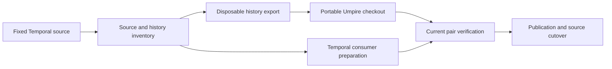

# Extract the standalone Umpire repository and retain the local Temporal loop

## Goal & Context

The owner asks to complete the migration, then continue the milestone backlog,
using delegated judgment and parallel agents. The Rust-tooling migration is closed;
the repository extraction described in `MIGRATE.md` remains unexecuted. Extract the
framework with its relevant history, give each source one owner, and preserve the
ability to use uncommitted framework changes from real Temporal consumers.

The independent framework workspace already exists. Reuse its local Cargo/tool
configuration, native gate, generator provisioning, guests and fixture ownership.
Source preparation proceeds under the recorded validation hold; required execution
and final cutover remain pending until that hold ends. A failed destination-access
probe does not prevent a recoverable local export.

## Architecture & Data Models

The framework checkout owns authoring, IR, checkers, generic protocol/runtime,
catalogs, fixture tooling, Go host and the Kettle reference. Temporal retains its
Models, API acquisition, realization, guest, host extension and server integration.
Cargo uses sibling path dependencies; a parent Go workspace selects the actual
server and nested consumer modules. CI reproduces the same pair at recorded revisions.



## Acceptance Criteria

- **R1:** Record the exact source revision, complete selected-file byte/mode/symlink
  inventory, archive identity, history boundaries, destination probe result, and
  retained-candidate ownership/transfer ledger. Errors: an unknown or inaccessible
  destination stays unknown; dirty and unintegrated work is retained, never silently
  incorporated, discarded or declared transferred. Freeze newer source checkpoints
  explicitly rather than mutating an earlier inventory.
- **R2:** Produce a local export only in an isolated clone, retaining Rust lineage
  through all earlier framework/host/tool paths, relevant authors/dates/messages,
  and an old-to-new commit map. The extracted checkpoint exactly matches R1's
  selected source bytes, modes and symlink targets. Errors: revision qualification
  excludes Scala that formerly occupied the same paths; both sibling archive-move
  histories are included; destination collisions, omitted fixtures and mismatched
  trees fail the inventory comparison. Do not filter the working repository or its
  shared object directory.
- **R3:** A framework-only checkout owns all required support, focused documentation,
  attribution, agent instructions, native command aliases and CI. Canonicalize both
  Go module identities and regenerate the corresponding descriptors together with
  imports and schema options. Preserve protocol package names, field numbers, ABI,
  guest ownership and all semantic golden payloads. Errors: no build depends on a
  Temporal/Scala sibling, personal absolute path, parent generator, or previously
  populated target; existing caller-context and source-boundary controls remain.
- **R4:** Actual Temporal Rust and Go consumers resolve the local framework source
  through sibling Cargo paths and a parent Go workspace; existing model commands,
  guest freshness and CI use that source explicitly. Errors: missing checkout fails
  with actionable setup instructions; no remote/cache fallback replaces local source;
  existing parent workspace entries are preserved; generated files follow their
  owning schema and the committed Temporal guest remains reproducible. Consumer
  finalization consumes R3's actual exported paths, Go identities and forwarding
  commands; provisional preparation may proceed earlier.
- **R5:** When execution resumes, verify the exact current standalone/consumer pair,
  including an isolated fresh-target framework gate, protobuf freshness, release
  tests, real host/guest parity and required paired gates in fresh paired checkouts.
  Require generated-code cleanliness, unchanged fixture metadata/payloads and
  archive/cache identity before and after cutover. Disposable uncommitted
  Rust and Go edits each cause recognizable Temporal consumer failures, then green
  after exact restoration, without commits/publication between each pair. Retain
  revision-bound commands/results and final timings. Errors: stale guests, omitted
  checks, historical proofs from different sources and pre-existing failures never
  establish success; preserve the existing performance obligations and report misses.
- **R6:** Inspect the real destination and preserve its history during publication.
  Cut over only after R5 and a complete candidate-transfer disposition naming each
  repository, recovery ref, tracker record and cross-repository prerequisite; update both
  repositories' current documentation, CI, agent and Flow/milestone references.
  Errors: publication and source removal remain separately authorized boundaries;
  absent access, unresolved destination conflicts or validation hold prevent those
  steps. Retain the source checkpoint, all unfinished branches/evidence and the
  unchanged Scala archive/caches; transferred obligations remain open.

## Boundaries

No Model/checker semantic changes, semantic golden refresh, registry publication,
prebuilt generic wasm, Git LFS, server feature completion, or retirement of the
Scala archive is part of extraction. This work does not close fn-254 performance,
fn-246 refinement or R40 live-evidence obligations. No remote writes, shared-history
rewrite, source deletion or replacement of existing developer workspaces during
preparation. Pending source candidates may be exported later from a new checkpoint;
their existence does not require finishing every open spec before local export.

## Early proof point

The source inventory and ancestry map establish the extraction boundary first.
The disposable export then proves exact selected-tree equality and representative
pre-move history before any portable-layout or consumer edits. A mismatch stops
adaptation until the map or filter is corrected.

## Quick commands

Source/inventory preparation uses Git object reads and comparisons. Build/test
commands remain deferred under the owner hold; when it ends, use the actual
standalone and paired entry points described in the migration plan, including:

```sh
git status --short
git rev-parse HEAD HEAD:model/umpire HEAD:model/archived
```

Do not infer current-source execution success from these structural checks.

## Decision Context

Copy the complete independent framework subtree rather than reconstructing its old
parent workspace. Preserve mixed historical support under a provenance namespace,
then remove those historical copies in a separate layout commit; they must not
overwrite current framework-owned configuration. Qualify history by ancestry, not
dates or path names: the two equivalent archive moves have different hashes.

The source checkpoint is `c88fdc5506`; its generic subtree has 1,177 tracked files.
The earlier standalone proof covers candidate `1217f4ce`, so it is precedent rather
than current extraction evidence. The current GitHub destination probe returns HTTP
401 and does not establish destination absence or emptiness.

## Memory findings

| Track | Category | Entry | Why relevant |
| --- | --- | --- | --- |
| bug | integration | Preserve caller context across nested workspace commands | Preserve canonical Cargo home and actual timed/untimed caller roots across the new checkout seam. |

## Conversation Evidence

Owner goal: "complete the migration and then work on MILESTONES.md; when in doubt
follow your own recommendations instead of asking for input. use sub agents to
parellize work."

## Requirement coverage

| Req | Description | Task(s) | Gap justification |
| --- | --- | --- | --- |
| R1 | Record the exact source revision, complete selected-file byte/mode/symlink inventory, archive identity, history boundaries, destination probe result, and retained-candidate ownership/transfer ledger. Errors: an unknown or inaccessible destination stays unknown; dirty and unintegrated work is retained, never silently incorporated, discarded or declared transferred. Freeze newer source checkpoints explicitly rather than mutating an earlier inventory. | fn-257-extract-the-standalone-umpire.1, fn-257-extract-the-standalone-umpire.6 | — |
| R2 | Produce a local export only in an isolated clone, retaining Rust lineage through all earlier framework/host/tool paths, relevant authors/dates/messages, and an old-to-new commit map. The extracted checkpoint exactly matches R1's selected source bytes, modes and symlink targets. Errors: revision qualification excludes Scala that formerly occupied the same paths; both sibling archive-move histories are included; destination collisions, omitted fixtures and mismatched trees fail the inventory comparison. Do not filter the working repository or its shared object directory. | fn-257-extract-the-standalone-umpire.2 | — |
| R3 | A framework-only checkout owns all required support, focused documentation, attribution, agent instructions, native command aliases and CI. Canonicalize both Go module identities and regenerate the corresponding descriptors together with imports and schema options. Preserve protocol package names, field numbers, ABI, guest ownership and all semantic golden payloads. Errors: no build depends on a Temporal/Scala sibling, personal absolute path, parent generator, or previously populated target; existing caller-context and source-boundary controls remain. | fn-257-extract-the-standalone-umpire.3, fn-257-extract-the-standalone-umpire.5, fn-257-extract-the-standalone-umpire.7 | — |
| R4 | Actual Temporal Rust and Go consumers resolve the local framework source through sibling Cargo paths and a parent Go workspace; existing model commands, guest freshness and CI use that source explicitly. Errors: missing checkout fails with actionable setup instructions; no remote/cache fallback replaces local source; existing parent workspace entries are preserved; generated files follow their owning schema and the committed Temporal guest remains reproducible. Consumer finalization consumes R3's actual exported paths, Go identities and forwarding commands; provisional preparation may proceed earlier. | fn-257-extract-the-standalone-umpire.4, fn-257-extract-the-standalone-umpire.5, fn-257-extract-the-standalone-umpire.7 | — |
| R5 | When execution resumes, verify the exact current standalone/consumer pair, including an isolated fresh-target framework gate, protobuf freshness, release tests, real host/guest parity and required paired gates in fresh paired checkouts. Require generated-code cleanliness, unchanged fixture metadata/payloads and archive/cache identity before and after cutover. Disposable uncommitted Rust and Go edits each cause recognizable Temporal consumer failures, then green after exact restoration, without commits/publication between each pair. Retain revision-bound commands/results and final timings. Errors: stale guests, omitted checks, historical proofs from different sources and pre-existing failures never establish success; preserve the existing performance obligations and report misses. | fn-257-extract-the-standalone-umpire.5 | — |
| R6 | Inspect the real destination and preserve its history during publication. Cut over only after R5 and a complete candidate-transfer disposition naming each repository, recovery ref, tracker record and cross-repository prerequisite; update both repositories' current documentation, CI, agent and Flow/milestone references. Errors: publication and source removal remain separately authorized boundaries; absent access, unresolved destination conflicts or validation hold prevent those steps. Retain the source checkpoint, all unfinished branches/evidence and the unchanged Scala archive/caches; transferred obligations remain open. | fn-257-extract-the-standalone-umpire.6 | — |

