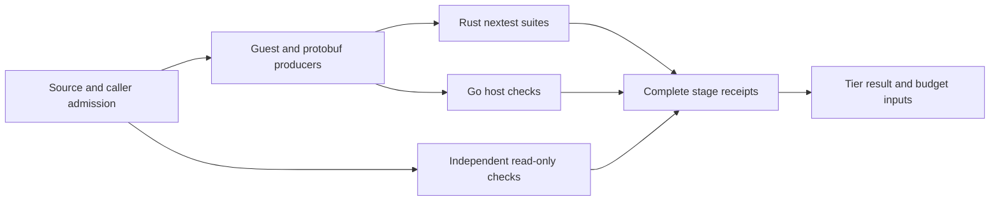

# fn-254-fast-validation-gates-and-a-real-inner.17 Maximum-throughput validation: uniform nextest and one bounded stage DAG

## Description
Make the production validation paths use available parallelism without omitting checks or building a second scheduler. Owner requested this task and made faster fn-254 validation the immediate priority on 2026-10-26.

**Size:** M
**Files:** existing framework/Temporal native gate and test-runner leaves; quick execution; mise task definitions; their wiring/standalone controls and entry-point documentation.
**Touches:** [Makefile, model/scripts/time-gate.sh, mise.toml, model/umpire/mise.toml, model/dev/xtask/src/gate.rs, model/dev/xtask/src/test_run.rs, model/dev/xtask/src/main.rs, model/umpire/dev/xtask/src/gate.rs, model/umpire/dev/xtask/src/gate/**, model/umpire/backends/process/src/support.rs, model/umpire/backends/process/src/syscall.rs, model/umpire/backends/process/tests/**, model/umpire/backends/process/Cargo.toml, model/umpire/dev/xtask/Cargo.toml, model/dev/xtask/Cargo.toml, model/umpire/Cargo.lock, model/Cargo.lock, model/umpire/dev/xtask/src/test_run.rs, model/umpire/dev/xtask/src/main.rs, model/umpire/dev/xtask/src/quick/**, model/umpire/dev/xtask/tests/**, model/scripts/test-model-validate.sh, model/scripts/test-time-gate.sh, model/umpire/README.md, model/umpire/dev/xtask/README.md, model/README.md]

### Ownership and order
- Consume completed .6's correct source-consumer selection, .11's isolated validation contract and .5's smaller independently schedulable cases. Keep all .6 direct consumer mappings and reverse dependencies; speed cannot come from selecting fewer affected packages.
- Own uniform production Rust test execution, the authoritative dependency/resource stage graph, and the root Makefile/timer wiring that invokes it. Route public `model-check`/`model-time`/`model-validate` through that graph so the current complete framework-then-Temporal ordering does not remain a separate outer scheduling definition. Preserve the public `cargo xtask gate` and `cargo xtask validate` entry points and their Make/CI/standalone caller, tier, status and output contracts. Put scheduler invocation beneath these interfaces. Any transitional shell timer changes are ported by .15. .5 owns fixture/compiler-case granularity, UI conversion, compiler reuse, JVM group sizing and legacy/default-mode cleanup. It must not add a custom stage scheduler that this task replaces.
- This is the highest-priority new task. Execute .6 closure, then .5's critical-path work, then this task. Download provisioning .16 and remaining shell ports .15 follow it; .12/.8 consume its final graph/counts. Do not depend on fn-246 or fresh baseline measurements.

### Approach

The graph below shows ownership, not permission to overlap every producer. Inventory the actual resource and generated-output edges before execution.

1. Route Rust unit/integration gate suites, including quick, through pinned nextest. Batch selected packages within each workspace rather than running a separate Cargo test command for every package. Reuse the existing test-runner leaves; preserve features, ignored selection, target/filter semantics, status propagation, fail-fast and stage timings. Keep Cargo for the corresponding doctests and compiler/build-only probes. Reject unexpected zero-test selections. The framework 24-case split must not rename Temporal's existing exact `fixtures` quick selector.
2. Use one authoritative stage dependency graph. Prefer mise's existing dependency/job scheduler over new Rust scheduling machinery when the installed mise can preserve the current contracts. Verify that capability once during implementation with a bounded tool probe before adopting it. If mise schedules stages, declare `min_version` in both task-owning configs (`mise.toml` and `model/umpire/mise.toml`) at the minimum version whose required dependency, failure and job semantics were verified. This is declarative tool admission; production entry points do not run version or capability probes. Native xtask keeps project-specific checks, admission and structured receipts. Choose the single graph source and remove every independently maintained duplicate stage-order/dependency definition, or derive it from that source, including native stage lists, mise dependencies and root wiring. If a concrete contract requires minimal native supervision, retain only that supervision and document the reason. Do not introduce a second graph or scheduler.
3. Overlap only independent stages. Model actual Cargo target locks, generated-file producers, fixture/snapshot writes, native/guest consumers and Go/live resources as edges or explicit admission. Apply one combined host allocation across mise jobs, nextest groups, compiler jobs and nested TLC recovery. Inherit .5's verified per-invocation JVM bounds. Until an explicit combined admission proof permits overlap, enforce conservative mutual exclusion among JVM-bearing framework-tests, Temporal-tests, standalone-child tests and quick-TLC work. Use shared admission across independently running invocations and the parent/isolated-child boundary, with a child handoff that cannot deadlock on its parent's lease. A nextest group or global slot count applies to its invocation and is not a cross-invocation host cap. Increasing job counts is not itself a resource proof. Preserve caller target/Cargo-home semantics and source-only standalone execution.
4. Preserve real named failures, fail-fast, owned sibling cancellation/reaping, simultaneous failure reporting and deterministic logical reports. Keep invocation-local complete stage/count receipts with duplicate/missing/partial records rejected. Mise task freshness or timestamps must never substitute for actual required validation. Keep authoritative full-gate cache disable, disabled tool auto-install and explicit optional Apalache behavior.
5. Record current-candidate throughput with exact inputs, profiles, selected/executed/ignored inventories, CPU/JVM bounds and stage timings. The correct five-package quick run was 444.027 s, including 388.875 s of realization tests despite 14 TLC cache hits. Earlier approximately 20 s runs omitted affected consumers and are historical incomplete coverage, not the current SLO. Use existing comparable evidence; do not create a fresh pre-optimization baseline campaign or claim unmeasured savings.

### Verification and boundaries
- Prove Cargo/nextest package/binary/test/ignored equivalence for the changed paths, consuming .5's explicit framework umbrella-to-24-case mapping and preserving separate doctests. All unchanged tests and required native/interpreter execution remain selected.
- Exercise real changed entry points with focused mode, dependency, resource, source mutation, failure/cancellation/reaping and stage-receipt controls. Prove shared JVM exclusion with independently running gate/quick invocations and the isolated-child handoff; synthetic per-nextest slot assertions do not establish this cross-invocation bound. Reuse unchanged evidence by exact input closure. Once the scheduler candidate is frozen, renew the real standalone control it changes; retain unrelated combined/final measurements for .8. Synthetic wiring controls are not production-suite evidence.
- No Model policy changes, arbitrary test skips, reduced TLC determinism checks, timing-only warnings for backend refusals, extra test binaries, registry package/version/checksum changes, generic task cache, or artifact-publication redesign. Keep parent and isolated-child suite authority/output obligations intact.
- Document the single graph owner, public commands and resource limits. Register the graph/count interfaces for .12; keep final throughput target/miss reporting with .8.

### Supervision decision from actual tool evidence (2026-10-26)

The actual pinned mise2026.10.11 probe in `task17/resumed/mise-capability-probe.json` verifies dependency/jobs/default fail-fast behavior but demonstrates descendant cleanup gaps, including a timeout returning while a descendant remains alive. Mise remains the sole DAG scheduler; native code owns process lifetime, cancellation, lease custody and receipts only.

Reuse the existing backend-process supervisor rather than introducing shell kill/PID enumeration or another unsafe boundary. The earlier unchanged-lock restriction is narrowed only to permit necessary in-workspace dependency edges: expose the minimal owned orchestration API, add the framework xtask-to-process edge, and promote Temporal's existing xtask dev edge when needed. Preserve the exact registry tuple union (119) and all package versions/checksums; no provider/accounting changes or mixed assembly lockfiles. Port policy/supervision changes selectively and retain existing Checker defaults and platform prevention controls.

One coarse outer JVM invocation lease is the conservative first proof. The native cleanup supervisor must retain the same locked open-file description until all owned descendants are reaped, including abrupt outer-owner death. Parent/isolated-child delegation must carry verified descriptor authority without reopening/reacquiring its own lock or trusting an environment boolean. Other invocations must remain excluded throughout cleanup.

The retained Orchestration proposal does not establish escaped/adopted-descendant ownership on Darwin. Preserve existing platform behavior and checks, investigate the narrow native contract, and keep this obligation explicit; Linux subreaper evidence alone does not establish portable cleanup. Linux execution and source checks remain required. On 2026-10-27 the owner explicitly deferred macOS validation for now; this deferral permits current task acceptance without a Darwin execution verdict, while preserving platform behavior and recording the unproved cleanup obligation. The source reports `lease-supervision-design.md` and `process-supervision-design.json` record the evidence and remaining uncertainty.

### Source-grounded preparation
Use `.flow/tmp/fn254-throughput-plan/{repo-scout,spec-scout,gaps}.md`, .5's fixture/JVM decisions and the retained .6/.11 proofs. Official references: https://nexte.st/docs/running/, https://nexte.st/docs/configuration/test-groups/, https://mise.jdx.dev/tasks/architecture.html. These establish tool capabilities, not measured repository speedups.

### Owner macOS validation deferral (2026-10-27)

The owner answered the runner question with **“skip osx validation for nw”**. Do not run or install a macOS validation toolchain for the current milestone pass. Continue Linux proof, review and subsequent milestones. Preserve Darwin code and Checker prevention; make no Darwin runtime acceptance or universal descendant-cleanup claim. Keep the deferred validation visible in MILESTONES.md and final proof records until the owner resumes it. This is a validation deferral, not removal of platform support.
## Acceptance
- [ ] Production Rust unit/integration gate paths, including correctly scoped quick tests, use pinned nextest with matching package/binary/test/ignored coverage; Cargo doctests and compiler-only probes retain their distinct roles. Target/filter, empty-selection, failure and timing controls pass.
- [ ] One authoritative stage DAG schedules dependency-independent work with the verified mise capability or a documented concrete native requirement; no parallel duplicate graph/scheduler remains. Public xtask gate/validate and Make/CI/standalone contracts are preserved with scheduling beneath them. A mise-based scheduler declares the verified minimum version in both task configs without runtime probes. Shared target/generated-output/caller/standalone obligations are preserved.
- [ ] Combined compiler/test/JVM/Go admission is bounded, including nested TLC workers. JVM-bearing framework-tests, Temporal-tests, standalone-child and quick-TLC work remain mutually exclusive across independent invocations until an explicit combined proof admits overlap; shared lease/handoff controls pass. Actual parallel execution and peak-owner controls establish the candidate bounds without claiming sampled RSS is a hard heap limit.
- [ ] Named failures, fail-fast, owned sibling cleanup, simultaneous failures, deterministic invocation-local receipts, full-gate cache bypass and no-auto-install controls pass; the changed real standalone validation is renewed on the frozen candidate.
- [ ] Documentation and .12 stage/count interfaces identify the single scheduler and resource contract. Current comparable quick/validation timings and any target misses are reported honestly, preserving all affected consumers and deferring unrelated final .8 gates rather than claiming them green.

## Done summary
TBD

## Evidence
- Commits:
- Tests:
- PRs:
