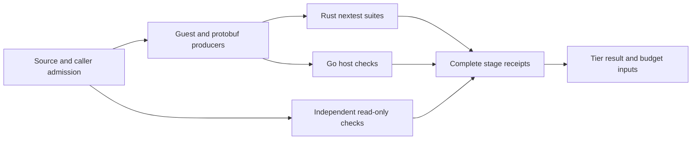

# fn-254-fast-validation-gates-and-a-real-inner.17 Maximum-throughput validation: uniform nextest and one bounded stage DAG

## Description
Make the production validation paths use available parallelism without omitting checks or building a second scheduler. Owner requested this task and made faster fn-254 validation the immediate priority on 2026-10-26.

**Size:** M
**Files:** existing framework/Temporal native gate and test-runner leaves; quick execution; mise task definitions; their wiring/standalone controls and entry-point documentation.
**Touches:** [mise.toml, model/umpire/mise.toml, model/dev/xtask/src/gate.rs, model/dev/xtask/src/test_run.rs, model/dev/xtask/src/main.rs, model/umpire/dev/xtask/src/gate.rs, model/umpire/dev/xtask/src/gate/**, model/umpire/dev/xtask/src/test_run.rs, model/umpire/dev/xtask/src/main.rs, model/umpire/dev/xtask/src/quick/**, model/umpire/dev/xtask/tests/**, model/scripts/test-model-validate.sh, model/scripts/test-time-gate.sh, model/umpire/README.md, model/umpire/dev/xtask/README.md, model/README.md]

### Ownership and order
- Consume completed .6's correct source-consumer selection, .11's isolated validation contract and .5's smaller independently schedulable cases. Keep all .6 direct consumer mappings and reverse dependencies; speed cannot come from selecting fewer affected packages.
- Own uniform production Rust test execution and the authoritative dependency/resource stage graph. .5 owns fixture/compiler-case granularity, UI conversion, compiler reuse, JVM group sizing and legacy/default-mode cleanup. It must not add a custom stage scheduler that this task replaces.
- This is the highest-priority new task. Execute .6 closure, then .5's critical-path work, then this task. Download provisioning .16 and remaining shell ports .15 follow it; .12/.8 consume its final graph/counts. Do not depend on fn-246 or fresh baseline measurements.

### Approach

The graph below shows ownership, not permission to overlap every producer. Inventory the actual resource and generated-output edges before execution.

1. Route Rust unit/integration gate suites, including quick, through pinned nextest. Batch selected packages within each workspace rather than running a separate Cargo test command for every package. Reuse the existing test-runner leaves; preserve features, ignored selection, target/filter semantics, status propagation, fail-fast and stage timings. Keep Cargo for the corresponding doctests and compiler/build-only probes. Reject unexpected zero-test selections. The framework 24-case split must not rename Temporal's existing exact `fixtures` quick selector.
2. Use one authoritative stage dependency graph. Prefer mise's existing dependency/job scheduler over new Rust scheduling machinery when the installed mise can preserve the current contracts. Verify that capability with a bounded tool probe before adopting it. Native xtask keeps project-specific checks, admission and structured receipts; remove or derive duplicate stage-order/dependency definitions. If a concrete contract requires minimal native supervision, retain only that supervision and document the reason. Do not introduce a second graph or scheduler.
3. Overlap only independent stages. Model actual Cargo target locks, generated-file producers, fixture/snapshot writes, native/guest consumers and Go/live resources as edges or explicit admission. Apply one combined host allocation across mise jobs, nextest groups, compiler jobs and nested TLC recovery. Inherit .5's verified JVM bounds; increasing job counts is not itself a resource proof. Preserve caller target/Cargo-home semantics and source-only standalone execution.
4. Preserve real named failures, fail-fast, owned sibling cancellation/reaping, simultaneous failure reporting and deterministic logical reports. Keep invocation-local complete stage/count receipts with duplicate/missing/partial records rejected. Mise task freshness or timestamps must never substitute for actual required validation. Keep authoritative full-gate cache disable, disabled tool auto-install and explicit optional Apalache behavior.
5. Record current-candidate throughput with exact inputs, profiles, selected/executed/ignored inventories, CPU/JVM bounds and stage timings. The correct five-package quick run was 444.027 s, including 388.875 s of realization tests despite 14 TLC cache hits. Earlier approximately 20 s runs omitted affected consumers and are historical incomplete coverage, not the current SLO. Use existing comparable evidence; do not create a fresh pre-optimization baseline campaign or claim unmeasured savings.

### Verification and boundaries
- Prove Cargo/nextest package/binary/test/ignored equivalence for the changed paths, consuming .5's explicit framework umbrella-to-24-case mapping and preserving separate doctests. All unchanged tests and required native/interpreter execution remain selected.
- Exercise real changed entry points with focused mode, dependency, resource, source mutation, failure/cancellation/reaping and stage-receipt controls. Reuse unchanged evidence by exact input closure. Once the scheduler candidate is frozen, renew the real standalone control it changes; retain unrelated combined/final measurements for .8. Synthetic wiring controls are not production-suite evidence.
- No Model policy changes, arbitrary test skips, reduced TLC determinism checks, timing-only warnings for backend refusals, extra test binaries, Cargo lock changes, generic task cache, or artifact-publication redesign. Keep parent and isolated-child suite authority/output obligations intact.
- Document the single graph owner, public commands and resource limits. Register the graph/count interfaces for .12; keep final throughput target/miss reporting with .8.

### Source-grounded preparation
Use `.flow/tmp/fn254-throughput-plan/{repo-scout,spec-scout,gaps}.md`, .5's fixture/JVM decisions and the retained .6/.11 proofs. Official references: https://nexte.st/docs/running/, https://nexte.st/docs/configuration/test-groups/, https://mise.jdx.dev/tasks/architecture.html. These establish tool capabilities, not measured repository speedups.

## Acceptance
- [ ] Production Rust unit/integration gate paths, including correctly scoped quick tests, use pinned nextest with matching package/binary/test/ignored coverage; Cargo doctests and compiler-only probes retain their distinct roles. Target/filter, empty-selection, failure and timing controls pass.
- [ ] One authoritative stage DAG schedules dependency-independent work with the verified mise capability or a documented concrete native requirement; no parallel duplicate graph/scheduler remains. Shared target/generated-output/caller/standalone obligations are preserved.
- [ ] Combined compiler/test/JVM/Go admission is bounded, including nested TLC workers. Actual parallel execution and peak-owner controls establish the candidate bounds without claiming sampled RSS is a hard heap limit.
- [ ] Named failures, fail-fast, owned sibling cleanup, simultaneous failures, deterministic invocation-local receipts, full-gate cache bypass and no-auto-install controls pass; the changed real standalone validation is renewed on the frozen candidate.
- [ ] Documentation and .12 stage/count interfaces identify the single scheduler and resource contract. Current comparable quick/validation timings and any target misses are reported honestly, preserving all affected consumers and deferring unrelated final .8 gates rather than claiming them green.

## Done summary
TBD

## Evidence
- Commits:
- Tests:
- PRs:
