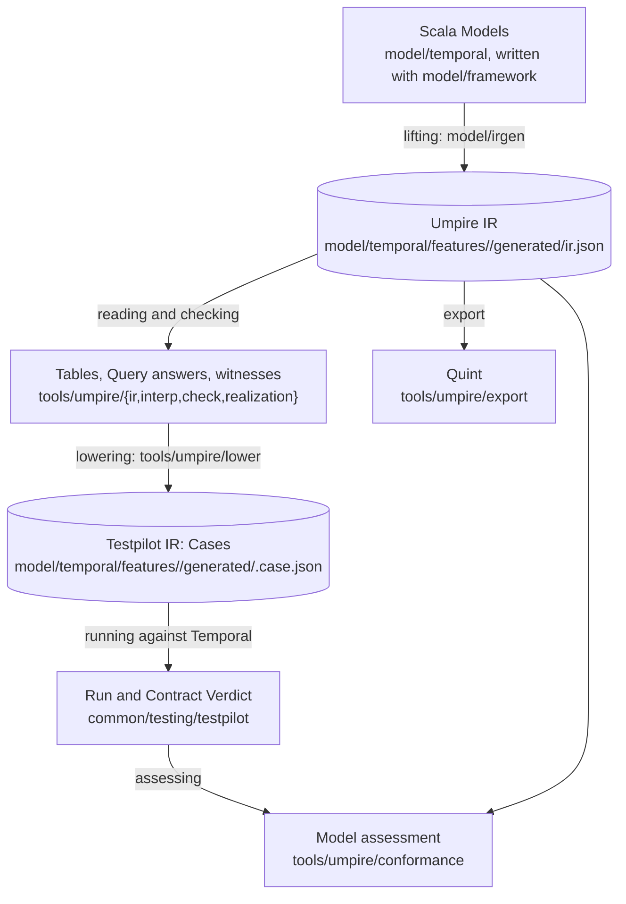

# The Temporal behavior model

This directory holds a description of how Temporal features are expected to behave, written so
that tools can use it. You describe a feature once, as a small state machine and the promises it
makes. From that one description you get:

- **A check of the description itself.** The Go evaluator walks every path the state machine allows,
  within stated limits, and reports any path on which a promise fails.
- **Generated tests.** A path that shows a promise at work becomes a test that runs against a real
  Temporal server. Nobody writes the test by hand.
- **A judgment of what the server did.** The record of such a test is checked twice: against the
  test's own pass conditions, and against the description as a whole.
- **Second opinion.** The same description is exported to Quint, and its answers are compared
  with ours.

Paths on this page are relative to the repository root.

## The terms, with one example

The example is one promise about a Nexus operation, which is a call a workflow makes to a handler
in another service: when the handler answers the call synchronously, the operation succeeds and the
workflow history records its completion. The example runs through the whole page.

A **Model** is the description of one feature: its state machines and everything declared about
them. A **machine** is a finite state machine: its states, the actions that can happen, and a step
function per action that says what the next state is and which facts the step records. The Nexus
caller Model is in `model/temporal/features/nexus/workflow`, and its machine `nexusProtocol` is declared in
its Protocol level's file, `protocol/Protocol.scala`, as the object `NexusProtocol`, which is the machine:
its rules say when each action fires and its effects what it does.

A **witness declaration** states one path and what its last step records. This spelling of the
Nexus caller's synchronous completion claim belongs in `NexusProtocol.queries`:

```scala
val syncCompletion = witness(caller.schedule(), handler.reply(Reply.syncSuccess))
  .records(Fact.nexusOperationCompleted)
  .ends(_.phase == Phase.succeeded)
  .limits(two)
  .live(satisfied)
```

The caller schedules the operation and the handler replies synchronously. `.records` requires
the last step's completed fact; `.ends` also requires its resulting state to be succeeded. The
state predicate is optional when the fact alone states the claim.

Each action is written with the actor that takes it: the feature declares the caller's actions in
`object caller` and the handler's in `object handler`, so `caller.schedule` is the caller's.
The path starts where the machine does, in `unscheduled`, the state before the operation exists.
`caller.schedule()` uses each input token's declared default, `unset` in this example;
`caller.schedule(scheduleToStart := expires)` sets one by name. Real Nexus sources await the
owner's migration sweep to declare those defaults explicitly.

A **Property** is a condition the selected steps must meet. A **Scenario** is a start state and
schedule of classes. A **Query** joins them within Limits: `find` asks for one path that puts the
Property to work, and `verify` checks it on every path of the Scenario. The witness lifts to this
exact ordinary triple, with one name for all three and no new IR construct:

```scala
object properties:
  object safety:
    val syncCompletion = property("syncCompletion") when handler.reply(Reply.syncSuccess) holds
      (after => after.records(Fact.nexusOperationCompleted) && after.state.phase == Phase.succeeded)
object queries:
  val syncCompletionPath = scenario("syncCompletion").actions(
    caller.schedule(), handler.reply(Reply.syncSuccess)
  )
  val syncCompletion = (query("syncCompletion") find properties.safety.syncCompletion in
    syncCompletionPath limits two).live(satisfied)
```

The generated Property selects exactly the last class, `handler.reply(Reply.syncSuccess)`, and
tests the recorded fact together with the `.ends` predicate. The generated Scenario starts at the
machine's init and pins the two classes in order. Keep the triple when a Property or Scenario is
shared with another Query. The existing Nexus source currently spells this claim as the triple
with `syncSucceeds` and `syncReplied`; the witness above is its equivalent authoring form.

The primary `.records(fact)` may instead be `.excludes(fact)`, which requires that fact to be absent.
After either primary, `.excludes(fact)` appends an unconditional absent-fact guard.
After the primary, `.recordsWhen(condition, fact)` requires another fact only when the after-state
condition is true. Its core is `!condition(after.state) || after.records(fact)`, conjoined with
the primary fact, every earlier conditional clause and the optional `.ends` predicate. A composition
uses `.recordsWhen(condition, _.member -> MemberMachine, fact)` to select that member's typed fact.
Clauses accumulate in written order and survive `.ends`, `.limits`, `.live` and `.explore`;
they do not finish a witness that has not stated its primary `.records` or `.excludes`.
Composed `.excludes(_.member -> MemberMachine, fact)` keeps the selected member's fact identity.
Keep `query verify` for invariants over every trace. If the last class occurs earlier in the
path too, write a triple: a witness is refused because its same-step Property would test both.

A witness is a Query owned by the machine or composition on which it is declared, as are its
generated Property and Scenario. Inside the owner, `witness(...)` uses that owner; elsewhere use
`m.witness(...)`. Its `val` names the Query; use `witness("name")(...)` when no val supplies a name,
such as an item in a helper's list. A composition uses its `own` or `synced` classes and records a
member's fact with `.records(_.member -> MemberMachine, fact)`.

Without `.limits`, depth and schedule length are the number of listed classes and the search
budget is 512; the lifted Limits take the Query's name. Here `.limits(two)` replaces that derived
value with the named `two` bound, explicitly preserving steps 2, actions 2 and search 512.
The path a `find` Query returns is its witness. The IR generator counts the Query's static
combinations, its total, 384 here, which the reader checks. An author may state it,
`limits two total 384`, and the gate holds it to the count; see
[Counting a Query's total](#counting-a-querys-total).
`.live(...)` is the authored Query switch for live Case generation; without it the Query is
model-only. A capability's expectation binding makes its generated Query live too.
The expectation states what a real run of this path should be judged as, here `satisfied`, the
Temporal kit's expectation (`model/temporal/realize/Kit.scala`) of a Run that completes, cleans up
and satisfies its Contract, and that the model assessment finds conformant with the Property
satisfied; see [Following the example to a Verdict](#following-the-example-to-a-verdict).

A **realization** says how to act a path out on a real server: which API calls perform each
action, and which recorded events are evidence of each fact. The Nexus caller's realization is
`model/temporal/features/nexus/workflow/realization/WorkflowNexusRun.scala`.

The remaining terms name what the tools produce:

- The **IR** (intermediate representation) is a language-neutral file format that tools read
  instead of source code. There are two, described in the next section.
- **Lifting** turns the compiled Scala Models into the first IR.
- **Lowering** turns a Query's witness, through its realization, into a Case.
- A **Case** is one executable test: a Program of instructions to run against Temporal, and a
  Contract of rules that the recorded evidence must satisfy.
- A **Run** is the record of one execution of a Case: an ordered list of events.
- A **Verdict** is the Contract's conclusion about one Run: `satisfied`, `violated` or
  `inconclusive`.

## The layers

Scala declares a Model, the IR generator reads its compiled declarations, and Go evaluates the resulting
IR. The Scala DSL supplies types and step functions for authoring; Go is the single Model evaluator.



Two IRs sit between the layers, and each has one writer side and one reader side:

- The **Umpire IR** is a lifted Model. Scala writes it (the IR generator); Go reads it (the reader,
  lowering, conformance, export and exploration under `tools/umpire`). Its schema is
  the nine-file closure rooted at `proto/internal/temporal/server/api/umpire/v1/ir.proto`.
  The checked-in files are `model/temporal/features/<feature>/generated/ir.json`. Go never runs Scala code: everything it knows about a Model comes from
  this file.
- The **Testpilot IR** is the Case, Run and Verdict format. Lowering writes Cases; Testpilot, the
  Case runtime, reads them and writes Runs and Verdicts. Its schema is
  `proto/internal/temporal/server/api/testpilot/v1`. Testpilot knows nothing about Models.

The current Testpilot format is exactly 4.0. Runtime predicates lower neutral Umpire operands to
canonical `cel.expr` ASTs evaluated by pinned `cel.dev/cel-go` v0.32.0; the finite Model evaluator
keeps its own expression semantics and does not import Testpilot. Descriptor-authoritative native
CEL values retain protobuf widths, enum identities and opaque message/Any payloads. Elapsed bounds
use protobuf Duration, checked for nonnegative exact whole milliseconds before conversion; runtime
timeouts must also fit their declared hard ceilings. Evidence declarations have one leaf schema and
one binder. Correlated tables identify each complete atom-plus-ordered-fields state separately and
share prior-state-independent action/destination/outcome/facts results without sharing transition
authorization. Historical Case formats and Runs are not relabeled or interpreted through fallback.

| Layer | What happens | Module | Command |
| --- | --- | --- | --- |
| Authoring | Models are written in Scala with a small DSL (a library of declarations such as `machine`, `property` and `query`) | DSL `model/framework`, Models `model/temporal` | `make lint-model`, `make fmt-model` |
| Lifting | The compiled Models are translated to the Umpire IR, built as the ScalaPB classes of its schema and written as ProtoJSON. A construct outside the supported subset is refused at its source line | `model/irgen`, run by the gate `model/check` | `make umpire-gen-model` writes `model/temporal/features/<feature>/generated`; `make umpire-check-model` requires it to be current |
| Umpire IR | The checked-in lifted Models | `model/temporal/features/<feature>/generated`; schema in `api/umpire/v1` | `make protoc` after a schema change |
| Reading and checking | Go loads and validates the IR, builds each machine's table, and answers every Property, Query and refinement | `tools/umpire/{ir,interp,check,realization}` | `go test -tags test_dep ./tools/umpire/...` |
| Lowering | A `find` Query's witness becomes a Case through its realization | `tools/umpire/lower` | `make umpire-gen-cases` writes `model/temporal/features/<feature>/generated`; `make umpire-check-cases` requires it to be current |
| Testpilot IR | The checked-in Cases, and `manifest.json`, which accounts for every Query | `model/temporal/features/<feature>/generated`; schema in `api/testpilot/v1` | |
| Running | Testpilot admits a Case, runs its Program through the Temporal Driver, records the Run and evaluates the Contract into a Verdict | `common/testing/testpilot`, `common/testing/testpilot/temporal` | `make umpire-check-live-tests` (in-process server); `make umpire-run` builds `.build/umpire-run` for any deployment |
| Assessing | The Run's evidence is compared with the whole Model | `tools/umpire/conformance` | part of the live tests above |
| Export | The IR is written for Quint, and its answers are compared with Go's | `tools/umpire/export` | `make umpire-check-backends` (needs the tools its README names) |

### Schema ownership

All nine files under `proto/internal/temporal/server/api/umpire/v1` keep the protobuf package
`temporal.server.api.umpire.v1`, Go package `api/umpire/v1` and JVM package
`io.temporal.server.api.umpire.v1`. A file owns declarations, not another generated package.

| File | Owns |
| --- | --- |
| `ir.proto` | `Model`, the root artifact |
| `common.proto` | Source positions |
| `value.proto` | Finite types and values |
| `expression.proto` | Functions, expressions and patterns |
| `machine.proto` | Actions, machines, channels, compositions, refinements, monitors, assumptions and holes |
| `claim.proto` | Properties, Scenarios, Queries, progress and expected Runs |
| `operand.proto` | Typed realization operands and protobuf data |
| `script.proto` | Script activations, commands and worker instructions |
| `realization.proto` | Realizations, roles, evidence, controls and API behavior |

`model/check` discovers the acyclic Umpire import closure from `ir.proto`, generates ScalaPB for
every file, and hashes the sorted paths and contents with the generator versions. An imported
schema edit invalidates the IR jar stamp. The linked API jar excludes the whole Umpire closure
so each IR class has one owner; linked Go descriptor freshness and Make prerequisites cover the
same files. An unchanged warm build reuses the stamped jars.

The marker arms use `google.protobuf.Empty`. Their containing oneof and field number carry their
meaning and presence. The descriptor ledger in `tools/umpire/ir/schema_test.go` retires the old local
`Empty` name and checks the relocated declaration union, historical wire data and every marker arm.
Testpilot continues to import its own schema only; lowering translates between the two IRs.

## Running the gate

The gate is the one command that checks the whole model pipeline:

```sh
make umpire-check-model
```

It is a Scala program, `model/check`. In order, it checks that the files under `model/` keep to the
model's own vocabulary, compiles and tests the DSL and the Models, runs the IR generator's own tests,
lifts every IR file the Models declare in one IR generator run (which first holds every Model to its
declaration order, [below](#the-reading-order-and-its-lint)), requires each feature's generated IR and
Cases to equal what it just produced, lints every IR file, and runs `go vet` and `go test` over `./tools/umpire/...`. It stops at the first failure
and changes no checked-in file. scala-cli, the JDK, protoc and Go come from the repository's
`mise.toml`.

After you change a Model, regenerate the checked-in files with the same program:

```sh
make umpire-gen-model     # the gate with --update: rewrites each feature's generated IR and Cases
```

Then read the diff of each feature's `generated/` directory like any other code change.

The gate then lints every IR file (`make umpire-check-lint` runs the lint alone): what a Model
declares that nothing reaches, takes, asks, evidences or realizes, and its specification holes, each
at its Scala line. It fails on a finding until you fix the Model or accept the finding with a reason
in `model/temporal/features/<feature>/generated/ir.lint.json`, and on an acceptance that no longer matches a finding. The coverage
summary it prints per machine is informational; no count fails the gate.

### Declaring source gaps (staged)

The framework now admits typed, repeatable source annotations, one per reason:

```scala
@gap(silent(client.cancel, in = Phase.running))(
  because = "cancellation after dispatch is not decided here", until = "fn-167 R2")
@gap(unconstrained(client.submit))(because = "the result claim is still missing")
object JobProtocol extends Machine[State, Outcome, Fact]: ...
```

`model/framework/Gaps.scala` declares a subject constructor for each current lint kind,
including `unreachableBinding` and optional `mustNotPinned`. Arguments are the Model's
actions, classes, choices, finite values, observations and typed API values or poll commands;
they do not spell finding identities as strings. `witnessOnly`, `unasked`, `unfired`,
`unrealized` and `unread` name the annotated declaration. `because` and optional `until`
are literal strings; the reason must be non-blank and a gap must name at least one subject.

The typed convention check admits machine, composition, facet, realization, Property,
Query and refinement declarations, refuses helper and test placements, lookalike acceptance
annotations and foreign subject factories, and permits ordinary compiler annotations such
as `unused`, `targetName` and `unchecked`. Internal TASTy extraction retains source order
and emits object/module mirrors once; genuinely repeated authored annotations remain distinct.

The lift then resolves each gap of a declaration it lifted (`model/irgen/Gaps.scala`) to the
finding keys the Go lint reports, `(kind, owner, subject)`. A machine's table kinds are owned by
the machine, a facet's by the machine that mixes it in; an action stands for its every class,
and `in` phases are listed in their enum's order (`move-fast in busy, done`). A realization owns
`uncovered` and `unreachableBinding`; its other evidence kinds, and those declared on a realized
machine, are its machine's. A Property's `witnessOnly`/`unasked` are its machine's and name; a
verify Query's `unfired` is its Property's machine's, a find Query's `unrealized` its Scenario's;
a refinement's `unread` is `<machine> refines <product>`. `unmapped` and `explicitWait` keep the
typed reference's identity until the shared transport binds them to the lint's field and
script spelling. The lift refuses a subject that resolves to nothing on its declaration (an
action the machine does not bind, a value of another type, a kind the placement does not own),
a finding key declared by two gaps (naming both positions), an `until` that names no Flow spec,
names a short id several specs share, or is malformed, and, in an IR-file run, a gap on a
declaration no IR file lifts. `except`/`overriding` waivers are collected beside the gaps as
`capability-waiver` entries with their reasons.

Nothing of this is written yet: the IR, its positions (a declaration's leading `@gap`s do not
move it), the fingerprint and `<file>.waivers.json` are what they were without the gaps. A source
`@gap` does not yet accept a Go lint finding: existing `.lint.json` and capability-waiver
transport remain required until the shared IR carries gaps.

Three kinds read a machine's table for what can happen in its reachable states, each at the Scala
line of what it names:

| Kind | Reported for | Fix |
| --- | --- | --- |
| `never-enabled` | an action class no reachable state enables | bind a rule that enables it, or drop it from the machine |
| `silent-rejection` | an actor's action disabled in a reachable state that is no end, by class and phase | a rule whose outcome says how the system answers it |
| `stuck-state` | a reachable state that is no end and enables no action class, a timer's and an internal step's included, with a shortest path to it; a state with a hole is not stuck, since the hole declares that unmodeled behavior may happen there | the rule a timer or an internal step is missing, or the state in the machine's `ends` if it is final |

`stuck-state` also reads each composition's reachable table, even where a member's refinement check
fails. A table that cannot be constructed remains a reader error; a failed refinement does not hide
an otherwise constructible table. A shortest witness is constructed only for a finding.

Capability waivers are not lint findings. The lifter writes their owner, Property and reason to
`<file>.waivers.json`; the model gate forwards that metadata into `<file>.lint.json` as
`capability-waiver` entries. Lint preserves those entries but neither reports nor judges them. A
check fails when the accepted file omits a current waiver or retains one the capabilities section
no longer states.

Each feature's `generated/ir.json` is collected from its package (fn-160): a form under a kind
(`features/activity/standalone`, file `activity-standalone`), or a kind's own package, a foundation
or an actor (`foundations/taskqueue`, file `taskqueue`) where it declares Queries or realizations.
Its roots are every machine, composition, `queries` section (a machine's or a facet's), machine
`capabilities` section, progress claim and realization declared in the package and its
sub-packages, but for a kind's forms, which are features of their own; the file holds them and
everything they reach, so a foundation machine a feature composes is lifted into the feature's
file, and its Queries into the foundation's own. Nothing lists the roots, so no Query, capability
or realization drops out of the IR by omission. The IR generator reads the compiled Models once
and lifts every file apart, with nothing carried from one to the next; a refusal follows a line
naming the file it was lifting. `lift --ir <jar=prefix> <classpath file> <directory> [name...]` is
that run, and `lift <jar=prefix> <classpath file> <out.json> <root>...` lifts the roots named by
their fully qualified names, as the IR generator's fixtures do.

The gate packages the linked Temporal API, Testpilot and well-known ScalaPB classes in
`model/build/api-scalapb.jar`. Its descriptor and tool stamp is checked before a build; editing a
Model reuses that jar. If the gate reports a missing or stale `proto/api.binpb`, run the named
`make proto/api.binpb` target; if it reports stale generated internal protobuf code, run
`make protoc`. The gate reports the declaration's source line when a typed selection cannot be
lifted. The compiler reports misspelled fields, wrong request or response roots and wrong value
types before lifting.

`make umpire-check-model MODEL_GATE_ARGS=--skip-go-checks` leaves out the `go vet` and `go test`
step, for when you run the Go tests separately; it still lints the IR. `go test -tags test_dep ./tools/umpire/...` runs the
Go side alone from the checked-in IR and needs no JVM.

### Sealing a batch

A batch that keeps the Models' meaning but changes their identities (renames, moved files, merged IR
files) is sealed by comparing the tree after it with a baseline captured before its first edit:

```sh
make umpire-capture-baseline OUT=/abs/new/dir            # on the clean tree, before the first edit
make umpire-check-equivalence BASE=/abs/new/dir MAP=renames.txt STEPS_ONLY=1   # while the generated IR is stale
make umpire-check-equivalence BASE=/abs/new/dir MAP=renames.txt                # after the regeneration
make umpire-check-equivalence BASE=/abs/new/dir MAP=/dev/null                  # an unchanged tree passes
```

The baseline (`model/check/Equivalence.scala`) holds `baseline.txt` (commit, whether `model/` was
clean, counts), `step-tables/`, copies of the lifted IR and accepted lint findings under the baseline
`ir/`, and Cases and `manifest.json` under the baseline `cases/`, and the Models' sources for reference. The check fails on
every difference the rename map does not explain, and on every map entry that explains nothing.

- **Step tables.** `model/framework/StepTables.scala` writes, for every machine and composition the
  IR files' roots reach (`IrFile.discover`, as `MachineTablePins` discovers them), its start, binding
  order, each state with its end and refinement image, and one row per state and action class with
  the ordered steps, disabled pairs included. A composition's table holds its members, its syncs and
  its ends. Values are spelled as the table pins spell them. The tables are read from the Models as
  Scala runs them, so they compare while the IR is stale and the IR generator does not build.
- **Projection.** Every IR declaration, keyed by section and identity, so how declarations are split
  across IR files does not matter; every accepted lint finding; every Case by file name; every
  manifest entry by its Query. Source positions, content fingerprints and IR files' root lists are
  left out.
- **Interpreter tables.** With `DUMPER=<path>` (the table pins' dumper,
  `model/testdata/table-pins/README.md`), capture also replays the pins and keeps the native
  streams, and the check dumps the current IR and compares the streams under the map.

The rename map has one entry per line, `#` starting a comment. `old new` renames the whole word
`old` everywhere: table keys (`<family>.<machine>`), rows, IR ids and strings, IR and Case file names.
A word ends at any character other than a letter, digit or `_`, so `pkg.Machine`, `worker.poll` and
`activity-standalone-race` are words, and renaming an IR file renames the Cases derived from it.
All entries apply at once, the longest first. `key -` removes a table, `key/actor.action -` removes
one action's rows from a table. With `STEPS_ONLY=1`, an entry that only the IR or Cases mention is
reported as left to the projection rather than as unused.

## Following the example to a Verdict

**Lifted.** `make umpire-gen-model` lifts the Query into `model/temporal/features/nexus/workflow/generated/ir.json`. For the
witness spelling above, its ordinary Query entry has this shape, with source positions and
exploration omitted. The existing ordinary source instead names its Property `syncSucceeds`
and its Scenario `syncReplied`:

```json
{
  "name": "syncCompletion",
  "form": "FORM_FIND",
  "property": {
    "machine": "nexusProtocol",
    "name": "syncCompletion"
  },
  "scenario": {
    "machine": "nexusProtocol",
    "name": "syncCompletion"
  },
  "limits": {
    "name": "two",
    "steps": 2,
    "actions": 2,
    "search": 512
  },
  "expectedRun": {
    "property": "OUTCOME_SATISFIED",
    "conformance": "CONFORMANCE_CONFORMANT",
    "contract": "OUTCOME_SATISFIED",
    "disposition": "DISPOSITION_COMPLETED",
    "cleanup": "CLEANUP_SUCCEEDED"
  },
  "total": "384"
}
```

The Property, the Scenario, the machine and its step functions are lifted into the same file the
same way, each with its Scala source position. Step functions become expression trees, which
[SEMANTICS.md](SEMANTICS.md) defines how to evaluate.

**Checked.** The Go reader builds the table of `nexusProtocol` from the IR and answers the Query:
it finds the two-step path and confirms that the completion Property holds on its last step.
That path is the witness.

**Lowered.** `tools/umpire/lower` turns the witness into the Case
`model/temporal/features/nexus/workflow/generated/syncCompletion.case.json`, with the Case ID
`temporal.case.scala.nexus-workflow.syncCompletion`. Its Program has three parts: a workflow that
schedules a Nexus operation, a handler that replies synchronously, and a controller that starts
the workflow and reads its history. Its Contract holds one rule. This is the rule, with the two
comparisons left out:

```text
"ruleId": "fact-nexusOperationCompleted",
"trigger": { … },
"response": { … },
"clock": "CORRELATED_CLOCK_OPERATION_TRANSITIONS",
"bound": "1",
"ending": "TRACE_ENDING_PARTIAL"
```

The trigger matches the step whose action is `schedule-unset-unset-unset`, and the response matches
a step whose fact is `nexusOperationCompleted`. In words: once the Run shows the operation
scheduled, the completed fact must follow within one more transition of that operation.
`model/temporal/features/nexus/workflow/generated/manifest.json` lists the Query as `lowered` and repeats what `.live(...)` declared.

**Run.** `tools/canary/assessment/testdata/nexus-workflow-syncCompletion-run.json` is a recorded Run
of exactly this Case against the in-process test server. It holds 27 events and ends with this
Verdict:

```json
{
  "status": "VERDICT_STATUS_SATISFIED",
  "rules": [
    {
      "ruleId": "fact-nexusOperationCompleted",
      "status": "RULE_VERDICT_STATUS_SATISFIED",
      "terminalStateId": "correlated.satisfied",
      "supportingEventSequences": ["9", "19"]
    }
  ],
  "supportingEventSequences": ["9", "19"]
}
```

Event 9 is the evidence that the operation was scheduled, and event 19 is the history's
`EVENT_TYPE_NEXUS_OPERATION_COMPLETED` event. To produce such a Run yourself,
run every lowered Case against an in-process server:

```sh
go test -tags 'test_dep integration' ./tests -run '^TestTestpilotGeneratedCases$'
```

**Two judgments, kept apart.** The Verdict above is the *Contract Verdict*. It says the Case's own
rule was met, and nothing more: the rule checks that the completion was recorded, not that the
operation's phase was `succeeded`, because a Property's clause about one field of the state does
not lower to a Contract rule yet.

The *model assessment* is the second judgment. It asks whether some execution the Model allows
explains all the evidence in the Run (conformance: `conformant`, `nonconformant` or
`inconclusive`), and what the Query's Property is on every execution that does (`satisfied`,
`violated` or `inconclusive`). The assessment is not stored in the Run. For `syncCompletion` the
declared expectation is a completed Run with a succeeded cleanup and a satisfied Contract, assessed
`conformant` and `satisfied`, and `TestTestpilotGeneratedCases` requires exactly that of a live
Run and of its replay, each value by equality (`lower.ExpectedRun.Check`). Conformance short of
`conformant` names the judge's reason the same way, as `forgedCompletion` declares
`conformanceReason = Some(Reason.incomplete)`: it is set exactly when conformance is not
conformant, the reader refuses an expectation that breaks that either way, and `Check` compares it
by id.

**What is not supported.** These limits are current and recorded, not hidden:

- `syncCompletion` is the only one of the Nexus caller's seven `find` Queries whose Property the
  assessment settles. The other six Cases run and satisfy their Contracts, but their Property stays
  `inconclusive`, because the Model also allows another execution that explains the same evidence
  and on which the Property fails or is never evaluated. Each Query's `.live(...)` names the
  reason by the judge's id (`Reason.explanationsDisagree`, `Reason.neverEvaluated`), whose wording
  is the judge's own (`tools/umpire/conformance/conclude.go`).
- Of the 340 Queries in the checked-in IR, 30 lower to a Case. 202 are `verify` Queries, which have
  nothing to run. 105 belong to machines that declare no realization yet. 3 standalone activity
  Queries are `unsupported`: their path needs something a Case cannot do or record in order yet,
  and the manifest names it at its source line.
- A Run samples one execution of the server. A satisfied Verdict is evidence about that Run, not a
  proof about every schedule.
- The recorded Run above was made on a test server. No Run of a real deployment is checked in.

## Where things are

| Path | What it holds |
| --- | --- |
| `model/framework` | The DSL: what an author writes a Model with. It names no Temporal concept. Realization declarations any system needs, the open traits a system's kit extends and the script helpers are in `framework/realize` |
| `model/temporal` | The Models: `features`, grouped by kind (`nexus`, `activity`) and form (`workflow`, `standalone`), with one general file per kind and the form's feature file below it; `foundations/taskqueue`, the task queue features compose; `actors`, the shared worker and client; `Bounds.scala`, every Query bound; `capabilities`, shared capability Properties; and `realize`, Temporal's realization vocabulary (`Realize.scala`) and shared kit modules |
| `model/irgen` | The IR generator. `testdata` holds Models it must lift and Models it must refuse |
| `model/temporal/features/<feature>/generated` | The feature's checked-in `ir.json`, accepted lint findings, Cases and `manifest.json`; retained supplemental outputs live in `legacy/` |
| `model/check` | The gate program. It generates the IR's ScalaPB classes from the schema into `model/build` (`--generate-ir`) and runs the IR generator once over every IR file the Models declare. Its second entry point, `umpire.check.metrics`, prints the source metrics of the Model folders it is given |
| `model/project.scala` | The build settings of the DSL and the Models |
| [SEMANTICS.md](SEMANTICS.md) | The evaluation rules of the Umpire IR: what every construct means |
| [Known bugs](../.plans/UMPIRE4_VISION.md#known-bugs-knownbugs) | Vision for acknowledging a known bug; not implemented |
| `model/build` | Build output of the gate; ignored by git |

The framework, `model/framework`, names no Temporal concept, in its prose or its identifiers, so a
Model of another system could be written in it. What a system has of its own its realization kit
declares, by extending the framework's open traits `Addressee`, `Activation`, `Instruction`,
`Recorded`, `Setting`, `Behavior` and `SystemStep`. Temporal's are in `temporal.realize`: `Role` and
`RoleKind`, the worker activations `WorkerActivation.{Workflow, NexusHandler, Activity}`, the
instructions `WorkerInstruction.{AttemptFailure, AttemptCanceled, AttemptWithheld, Fault, WorkflowCommand,
NexusReply, NexusCompletion}` with `FaultKind`, the history read `WorkflowHistory.event`, the
dynamic-configuration `RequiredSetting`, and the API behavior hints `ApiBehavior` and `ServerStep`
with `WaitBound`, `Visible`, `CauseKind`, `AttemptNumbering` and `InstructionLimit`. `TestFrameworkNamesNoTemporal` in `tools/umpire/ir`
fails when a file under `model/framework` names a Temporal term, the eight capability kinds among them; a
mention stays only under an allowance that states its reason, and none has one today. The
tooling downstream of the DSL is Temporal's driver tooling by design: the IR generator matches the kit's
vocabulary by fully qualified name and writes it into the IR's realization messages, whose names are
Temporal's, and lowering turns a Query into a Testpilot Case the Temporal Driver runs.

The module map, [.plans/UMPIRE_MODULES.md](../.plans/UMPIRE_MODULES.md), states each module's job,
its public interface and what it may import. Each module outside this directory has its own README:

- [tools/umpire](../tools/umpire/README.md): the Go tooling that reads the Umpire IR, and its commands.
- [tools/umpire/export](../tools/umpire/export/README.md): the Quint comparison.
- [common/testing/testpilot](../common/testing/testpilot/README.md): the Case runtime and the Testpilot IR.
- [common/testing/testpilot/temporal](../common/testing/testpilot/temporal/README.md): the Temporal Driver.
- [tests/testcore/testpilot](../tests/testcore/testpilot/README.md): the Cases the functional tests pin.
- [tools/canary](../tools/canary/README.md): the canary, which runs one pinned Case against a
  production deployment when an operator dispatches it.

## Writing a Model

Model targets accept `FEATURES`, space-separated form folders relative to
`model/temporal/features/` (for example, `FEATURES=nexus/workflow`). The default
discovers every feature file; selected forms keep their kind-level signatures,
shared code, framework and foundations. Each feature owns its generated IR,
accepted lint findings, manifest and Cases in its own `generated/` directory.
`make model-mini` delegates to `make model FEATURES=activity_mini`. Packaging the IR
and linked-API jars (`model/build/ir-scalapb.jar`, `api-scalapb.jar`) runs protoc and
Go over the API descriptors, which is held with `make protoc`, so the model targets
never package them: they read the cached jars and, when one is missing, fail naming
`make gen-model-api`, the opt-in target that packages both when their inputs changed.
The canonical gate (`make umpire-check-model`, `umpire-gen-model`) still regenerates
them. While the IR schema's Go code is older than the schema, the loop skips its Go
checks (Go reader, IR lint, Case lowering) and names each skip, ending with
`Scala stages passed; NOT run (held Go checks)`. The stages compose, each honoring
`FEATURES`:

```
make compile-model FEATURES=activity_mini   # compile the selection
make lift-model FEATURES=activity_mini      # package it and lift into LIFT_OUT (default: a
                                            # fresh model/build/history/lift.*), each feature
                                            # reported current or differing from its checked-in IR
make umpire-check-equivalence FEATURES=activity_mini STEPS_ONLY=1 \
  BASE=.flow/tmp/scala-dsl/mini-selected-baseline-00d22597d2 MAP=<rename map>
make model-mini [MODEL_GATE_ARGS=--skip-lint]  # the whole loop
```

Inventory tests report feature drift as
`behind` and absent IR as `missing`, without changing the independent native
baseline; the owner's full-set sweep must still establish every feature as current.
During the current owner-approved Scala DSL batch, a step closes on focused mini/shared
checks; broad validation and independent review run once at batch end, and the full-set
gate follows the owner's real-feature sweep. Standalone activity and Nexus are behind by
design. The Make route runs on the cached jars; a run that skipped the held Go checks
does not establish Case lowering, the Go reading of the IR or live execution.
For a run that defers lint, `MODEL_GATE_ARGS=--skip-lint` skips IR and Scala
syntax/style lint while retaining the fresh-IR Go reader and lowering checks;
the default loop still runs lint.

The smallest complete feature is [activity_mini](temporal/features/activity_mini/MiniActivity.scala).
Read its three levels in order: [Product](temporal/features/activity_mini/product/Product.scala),
[Protocol](temporal/features/activity_mini/protocol/Protocol.scala), then
[MiniActivityRun](temporal/features/activity_mini/realization/MiniActivityRun.scala) and its
[Kit](temporal/features/activity_mini/realization/Kit.scala). The signature's header names
these hard instances, and the tree shows where each lives:

| Concept | Committed mini declaration |
| --- | --- |
| Refinement | `ActivityProtocol.refinement` maps to `ActivityProduct`; `terminalThroughProduct` verifies the Product's `terminalRemains` |
| Shared input | `scheduleToStart` on `client.start` and `protocol.taskQueue.schedule` |
| Shared status | Protocol `backingOff` and `scheduled` both record `Fact.statusScheduled` |
| Facets and cross-facet guard | Product and Protocol `Dispatching` / `Completion`; Completion's schedule deadline reads `dispatching.states.waiting` |
| Capabilities and waivers | Product `Pollable` / `Closable` with reasoned `except(closedIsRejectedUniformly)`; Protocol `Retryable` / `Expirable`, overriding `failureReturnsToWaiting` with `retryBacksOff` and its reason |
| Composition | `Queue` composes `ProtocolMember` and `QueueScheduled`; its poll/deliver sync and `queueDelivery` claim |
| Channel and failure model | `AnswerDispatch`, `Answering` and `AnswerFaults`: capacity-one FIFO lossy `answers` channel and `AnswerState`'s explicit finite inbox catalog |
| Negative control | `AnswerTrusting` rebinds answer delivery to `trust`; `staleAnswerFound` / `staleAnswerRejected` exercise stale settlement |
| Progress | `DispatchingProgress.workerStarts` under `workerFair = assume.fair(activityWorker.poll)`, restricted to poll and bounded by `Bounds.dispatchSteps` |
| Monitor, hole, assumption | `ActivityProtocol.monitors.attemptsNeverRewind`; `AnswerDispatch.monitors.cancelDuringBackoff` and `environment = delayedAnswersPossible` |
| Realization | `MiniActivityRun`: seven evidence kinds, typed deadline presets for one/two attempts, an Activity worker script and dispatch hold |
| Queries and expectations | Product `completed` witness / `terminalIsFinal` verify; Protocol `protocolCompleted.live(satisfied)` / `retryCompleted.live(inconclusive(Reason.explanationsDisagree, because = ...))`; named `Bounds.three` / `six` |

These `.live` declarations state what a Run should be judged as. Only `protocolCompleted`
and `retryCompleted` belong to `MiniActivityRun`; source compile/lift success is neither a
lowered Case nor an observed live Verdict. The retry explanation identifies missing second
delivery/backoff evidence; its text remains source-only and cannot supply a judge's result.
fn-166.4 owns lowering/live proof, .5 the complete loop, .6 the Case subtree and .10 the
production migration loader. The current focused source checks do not close those tasks.

### Migration as code

DSL changes ship a task-named Scalafix rule under `model/migrate/rules/`, prove it on copied `activity_mini` sources before the real-feature sweep, and follow `model/migrate/README.md`; production loading remains held in fn-166.10.

Use `Fn<spec>Task<task><Change>.scala` for the source and the same class/rule name.
[Fn166Task9QueueAlias](migrate/rules/Fn166Task9QueueAlias.scala) is the compiled worked
example: it renames the local import alias `foundationQueue` to `taskQueueSource` and
qualified uses in copied mini queue sources. Both spellings have fifteen characters,
refer to the same foundation action and retain every source coordinate. The isolated
proof compares the complete raw lifted JSON and waiver bytes before/after, with no
identity map, position removal or expected-change projection. Refusal fixtures cover
collisions, shadowing and unsupported uses; applying the rule twice converges.

From the repository root, the source-test route is:

```sh
mise exec -- scala-cli test --server=false model/migrate --test-only umpire.migrate.QueueAliasTest
timeout 600 /bin/bash model/migrate/prove-mini.sh
```

The fixture invokes Scalafix's pinned in-process patch application on the actual custom
rule. `Makefile`'s existing ScalaCLI fix route loads built-ins only and uses JDK 25 for
Scalafix 0.14.9; adding production rule loading/configuration and Make wiring is .10.
The example is not applied to authored mini or real-feature sources.

The current layout is transitional: each feature keeps `generated/ir.json`,
`generated/ir.lint.json`, `generated/manifest.json` and `generated/<query>.case.json`.
Supplemental historical IR, Cases and their manifest retain their original names
and bytes under the owner's `generated/legacy/` until fn-160 completes. The later
fn-166.6 task moves current Cases under `generated/cases/`; that layout is not
implemented here.

`make lint-model` checks formatting and lint rules for the DSL, the Models, the IR generator and the
gate; `make fmt-model` formats them and `make fix-model` applies the lint rewrites. A construct a
lint rule forbids where no rewrite keeps the behavior carries a line-scoped
`// scalafix:ok <rule>`.

Model lint reads what the IR generator made of a Model, not its Scala. After `make umpire-gen-model`,
`make umpire-check-lint` lints every feature's generated IR as the gate does: each finding at its Scala
line, then each machine's coverage summary. `go run ./tools/umpire/cmd/umpire-lint --tables
model/temporal/features/<feature>/generated/ir.json` adds each machine's table by class in the terms of model/SEMANTICS.md
("Modalities"), each cell MAY with its results, MUST NOT with its guard or `?` for a hole, beside the
claims that pin it. Fix a finding in the Model, or accept it with an entry of
`model/temporal/features/<feature>/generated/ir.lint.json` that names its `kind`, its `owner`, its `subjects` as lint prints them
and, under `because`, the reason; the gate fails on a finding neither fixed nor accepted and on an
acceptance that matches none.

A Model writes a declaration's type only where inference would give a different one, such as a
step function whose body is `disabled` or `stay(s)` (inferred with no facts), a `Long` written as
an `Int` literal, or a call whose type argument or `given` the expected type decides, or where the
IR generator needs it; the IR generator reads an inferred type as it reads a written one.

The IR generator reads what an author wrote, as written:

- **Declarations:** machine objects, `object M extends Machine[S, O, F]`, with an optional
  `Phased[S, P](projection)` parent naming their phase, their header members
  (`init`, `end`, `entity`, `evidence`, `unobservable`) and their sections (`states`,
  `refinement`, `effects`, `monitors`, `rules`, `properties` with its `safety` and `liveness`
  claim groups, `capabilities`, `queries`); derived
  machines, `object D extends Derived(m.op(…))`, of the derivations `restrict`, `rebind`,
  `extend`, `refining`, `assuming` and `unmonitored`; composition objects; action chains
  (`action`, `timer`, `internal`, `on`, `creates`, `input[T]`, `results`, `example`);
  input tokens, `val scheduleToStart = input[Timeout](default = Timeout.unset)` declared on an action with
  `.input(scheduleToStart)`, each input named after its token's `val`; classes, `flip`, the
  positional `start(unset, expires, unset)` and `start()`, every input at its declared default
  (`start(unset, unset, unset)`, and for an action with no input its one class);
  Properties, Scenarios, Queries, Limits, monitors, assumptions, holes, channels, compositions,
  progress claims and realizations. A composition names its members by field selector
  (`_.activity -> RecordMember`), and so do its `sync`, `replaces` and `withMember`; a `sync`
  with no name is named after its first member's action; a Scenario
  or `whenAction` of it names a sync by one member action it pairs, `c.synced(_.activity ->
  history.dispatch)`, and a member's own action by `c.own(_.activity, client.pause)`.
  A composition's bounded progress claim is `c.leadsTo(name)(from, to, within, under*)`, with
  predicates of the composed state; an assumption makes its composed steps fair with the same
  selectors, `assume.fair(c.synced(_.activity -> worker.poll), c.own(_.queue, queue.persistTask))`,
  every class of an action or, where the selector names one, that class. The lifter refuses an
  assumption that mixes a machine's actions with composed steps or selects two compositions, a
  claim whose assumption selects steps of another composition, and a machine that assumes composed
  fairness. The bound counts composed steps, a sync's once, and weak fairness does not shorten it
  (model/SEMANTICS.md, Progress); `system/DispatchProgress.scala` states the restrictions its
  one-step bound rests on, with the variant whose stopping worker refutes it. Composition progress
  is supported by the current Scala authoring, lifter and model-check path. It is model-only: no
  Case is generated from it, and this source support does not itself close fn-150's pending
  generated-consumer, gate or live evidence.
- **Shared claims:** `property` and `scenario` are declared on `Declares[S]`, the supertype of a
  machine and a composition, so one function over `m: Declares[S]` declares a Property on either.
  A function-valued argument of such a function names a def of the lifted sources, which the
  IR generator binds where the function is called, as it binds a machine argument; a type parameter
  reads as the type the call applies it to. A case class whose every field is a Property, Scenario
  or Query bundles claims: built by its constructor in such a function, it lifts as its claims, and
  `x.field` reads one back. Shared capability Properties are lifted sources too, in
  `model/temporal/capabilities/product` and `.../system`; the framework holds none.
- **Types:** enums with and without case fields, case classes, and bounded counters `UpTo[N]`: a
  field `attempts: UpTo[2]` has the values 0, 1 and 2, lifted as the IR int range 0..2, and a step
  writes one with `UpTo(n)`. Every enum and case class is a domain with no `derives` clause: the
  compiler derives its `Finite` catalog where one is first needed. A Model declares its own
  `given Finite[S]` only for a catalog that is not structural, such as a channel's `Inbox`.
  Fields and channel messages use `UpTo[N]`; plain `Int` declarations are refused even with a
  local `Finite[Int]`. Named opaque integer types keep their own `Finite.upTo` range.
  A phase enum may declare, on each case, the status fact a step that enters it records:
  `enum Phase(val status: Fact) extends Recorded[Fact]`, `case started extends
  Phase(Fact.statusStarted)`. The parameter is named `status` and has no default, so a case without
  one does not compile; the enum lifts as the same enum with no fields.
- **Phase roles** (`framework/Roles.scala`): a case of a phase enum takes roles in its own extends
  clause, `case backingOff extends Phase, Retrying`; Scala 3 makes each such case name its enum and
  refuses grouped cases with an extends clause. The roles are `Live`, which `Waiting`, `Held` and
  `Suspended` extend, and `Retrying` extends `Waiting`; and `Closed`, which `Succeeded`, `Failed`,
  `Canceled`, `Terminated` and `TimedOut` extend. A Model declares a role of its own by extending
  one, `trait Expired extends TimedOut`; a trait that extends none is not a role. A role adds no
  field and no state, so the enum's `Finite` values are those without roles, and a phase with no
  role is one where the entity does not exist yet. A role test lifts to membership in the cases of
  the phase's enum that have the role, inherited roles included, in declaration order, and the IR
  has no role construct: `p.in[Closed]` on a phase value lifts as membership in `succeeded, failed,
  …`; `when[Closed]` in a rule lifts to the same membership expression; and a type pattern,
  `case _: Closed`
  or `case q: Closed`, as the alternatives of those case literals. The Models' lint refuses
  `isInstanceOf`, which lifts as `p.in[R]` does. The IR generator refuses a role test on a value of
  no enum, of a role no case of the enum has, or against a type that is not a role, and refuses, as
  it declares the enum, a case that is both `Live` and `Closed`, has two of `Waiting`, `Held` and
  `Suspended`, or has two closure roles.
- **Step functions:** `if`, `match` with case, alternative, binding and wildcard patterns, local
  `val`s, `copy`, constructors, comparisons, arithmetic, list literals and `++`, and calls of other
  functions; `Step(…)` and `steps.because("…")` on steps written out, and named choices,
  `choose(committed -> …, redelivered -> …)` over tokens `val committed = choice`. `require`
  becomes the function's precondition; `ensuring` is not lifted. Only a step function, and a
  function it calls that gives steps, makes a step: the IR generator refuses `Step(…)`, `enter`, `stay`
  or a call of a step function at its line in a start, an `ends`, evidence, a refinement, a
  monitor, a Property, a progress claim or a Scenario's start (model/SEMANTICS.md, "Levels").
- **Realization script helpers** (core, `framework/realize/Scripts.scala`): `script(id, activation)`
  of `everyCase(command)`, `onPath(classes*)(command)` and `perform(step -> command, …)` items;
  `command(instruction, …)`; `rpc(role, method) { … }`, `readUntil(…) { … }`,
  `call.withFields { … }`, which appends assignments and keeps the call's name, and
  `call.extended { … }`, which appends assignments and reads as a command of its own;
  `aliasOf(command)(instruction)`, a command that takes another's name;
  `statusTable(fact -> value, …)`. A command is named after its `val` in kebab case
  (`val pauseActivity` is `pause-activity`) unless written out as `Command(id, …)`. Evidence that
  names a call, such as `answered(fact, call)`, matches every `withFields` variant of it, since
  each keeps the call's name. A feature file (a file under a `features` directory) writes the
  kit's lower-case instruction forms, `fault`, `hold`, `release`, `finish`, `command`,
  `awaitCommand`, `awaitLearned`, `attemptFailure`, `attemptCanceled`, `attemptWithheld`,
  `attemptPending`, `attemptHeartbeat`, `workflowCommand`,
  `nexusReply` and `nexusCompletion` (`temporal/realize/Kit.scala`), never their case classes, and
  never writes a command out with `Command(id, …)`: two commands of one realization share a name
  only through `aliasOf`, or as `withFields` variants of one call. The kit's evidence modules
  (`temporal/realize/Modules.scala`) declare once what realizations wrote alike:
  `RequestBase(role, "namespace" -> …, "activity_id" -> run)`, the fields every call on the base
  assigns first (a field by its protobuf name, at the request's top or in one message field);
  `DescribedStatus(calls, method, info, operation, status)(fact -> value, …)`, with
  `described(fact)`, `described.evidence` and `described.await(fact)` (named `await-<status>`); and
  `HistoryEvidence(key, factPrefix)(HistoryKind(fact, _.attributes.x), …)`, exhaustive kinds whose
  closing read names `evidence` in its `closes`. A class pattern is exact:
  `start(scheduleToStart := expires)` is the one class whose omitted inputs are at their token's
  declared default (`unset`), and it binds no other class of the action. `deadlines[M](action, call,
  value, unset)(input.sets(_.field), …)` binds every class of the action the declared `Timeout`
  inputs make, combined ones too, each the call with the expiring inputs' fields set to `value`; a
  class expiring an input it leaves out is unrealizable. `onPath(action)` of an action with inputs
  stands for each class its `deadlines` binds. An action with non-Timeout inputs uses an explicit
  Class preset instead of the bare action: those inputs retain their values, while Timeout inputs
  must be at their defaults. Several presets accumulate distinct class catalogs; a duplicate is
  refused. An activity script may use `onPath(deadline.startToClose)(attemptWithheld)` to offer no
  answer until the attempt's context deadline ends it. This is not a performance of the timeout,
  which stays a positively bounded server timer. One timer of one script has at most one such
  item, and a selected path takes it exactly once. Context withholding requires a declared
  start-to-close or schedule-to-close request-field basis; a heartbeat deadline is not an SDK
  context deadline. `attemptPending` instead returns the SDK's exact pending sentinel after the
  optional `attemptHeartbeat(details)` prefix. Its selected heartbeat timer must have a positive
  declared request-field basis. These linear attempt groups contain zero or one heartbeat and
  exactly one disposition; terminal-only groups retain their existing meaning. The local record
  proves heartbeat invocation, not server receipt. Bounded Describe reads requesting heartbeat
  details and count prove receipt; a retry witness additionally requires an actual HEARTBEAT
  failure and the next delivered attempt's completion. umpire-lint reports a binding of a class no
  realizable path reaches (`unreachable-binding`) and a class of a performed action a realizable
  path can take that no binding performs (`uncovered-class`), accepted with why where it is
  unrealizable. A declaration
  referred to by value is written as its id, a monitor as its name
  (`MonitorExpectation(terminalFinality, …)` in a Query's expected Run), and a fact as
  its enum case, or the companion of a case with fields. A lookup `table(fact)` is resolved when
  the IR generator lifts. The IR generator refuses a command no `val` declares, a `perform` or `onPath` with no
  class, a lookup of a fact its table lists twice or not at all, a request-scope line of an `rpc`
  or a `readUntil` that is neither `field(_.x) := v` nor `Assignment.typed(…)`, and evidence that
  records a case of another enum than the facts its machine records.
- **Sugar** (`framework/Syntax.scala`, lifted by `irgen/Syntax.scala`): `enter(state, facts*)`,
  `stay(s)`, `disabled`, `x.in(a, b, …)`, `a implies b` and `after.records(fact)`. Each is lifted to
  the IR its core form lifts to, and nothing else: `List(Step(accepted, state, List(facts*)))`,
  `List(Step(accepted, s))`, `Nil`, `List(a, b, …).contains(x)`, `!a || b` and
  `after.facts.contains(fact)`. `enter` and `stay` answer the outcome one
  `given Ok[Outcome] = Ok(Outcome.accepted)` names; `in` is written dotted and takes at
  least one member; `implies` reads its right side only where its left side holds. A composition's
  `after.records(_.member, fact)` lifts as `after.facts.contains("member_fact")`, the composed key
  it records. A named call `start(scheduleToStart := expires)` lifts as the positional
  `start(unset, expires, unset)`. The kit's `field(_.name) := operand`, in
  `temporal/realize/Syntax.scala`, lifts as `Assignment.typed(Field[Req, V](_.name), operand)`,
  where `Req` is the request type of the scope the enclosing `rpc` or `readUntil` opened; a message
  written out for a message field of the request assigns each field it sets.
  `proto[M] { field(_.x) := value }` lifts as `Proto[M](ProtoField.typed(Field[M, V](_.x), …))`,
  each value's protobuf kind read from its field, a nested message written in the scope after its
  field, `field(_.info) { … }`; and `read(path, cardinality).into(targets…)`, in a call's scope,
  lifts as a `ResponseRead.typed(…)` of the call's reads.
- **Blocks** (sugar, the same files): a section `val` of a machine object may declare a predicate
  as `val held = is { phase.in(Phase.started, Phase.cancelRequested) }` and a step function of the state alone
  as `val pause = effect { phase = Phase.paused; record(Fact.attempted) }`, beside the method forms
  `def held(s: State) = s.phase.in(…)` and `def pause(s: State) = enter(s.copy(phase = …), …)`, which
  stay valid. A block reads a field by its name and an `effect` block assigns it by name; each lifts
  as the function its method form gives, with a parameter `s` of the machine's state type. An
  `effect` block holds only straight-line field assignments, each field assigned at most once and
  not read after it, `record(facts*)`, which appends in call order, or a lone
  `reject(Outcome.rejected(Rejection.notFound))`, which lifts as
  `reject(Outcome.rejected(Rejection.notFound), s)`; a block that records
  nothing enters the assigned state with no fact. Assigning a field whose values declare their
  status (the enum declaration above) records that case's status after the block's own facts,
  even when the value is the one the step starts in, and recording it again with `record` is
  refused; a rejecting block records none. The fields are read and assigned by accessors the level
  file declares after its types, each of one fixed shape: `def phase(using v: View[State]): Phase =
  v.get(_.phase)`, `def phase_=(p: Phase)(using d: Draft[State, ?, ?]): Unit = d.set(_.copy(phase =
  p))`, and for a field whose values declare their status `def phase_=(p: Phase)(using d:
  Draft[State, ?, Fact]): Unit = d.set(p)(_.copy(phase = p))`. The IR generator refuses an accessor
  of another shape and every other statement in an `effect` block, naming it and its position, and
  a block written anywhere but as a section `val`. `ActivityProduct` is written in these forms.
- **Claim patterns** (sugar, the same files): `once(over).keeps(_.x)`, `never(to)`,
  `never(to).from(before)`, `stays(p)` and `stays(p).unless(release)` on a Property builder, each
  lifted to the Property its lambda declares: `holdsAcross((before, after) => !over(before) ||
  after.state.x == before.x)`, `holds(after => !to(after))`, `holdsAcross((before, after) =>
  !before(before) || !to(after))`, `holdsAcross((before, after) => !p(before) || p(after.state))`
  and the same with `|| release(after)`. Each predicate is lifted as `holds` lifts its lambda and
  called from the Property's function; `keeps` takes a field path, or a def whose body is one.
- **The monitor pattern** (sugar, the same files): `val retainedOutcome = sticky(outcomePreserved)`
  and `val ownerAcknowledgment = stickyAcross(ackOnlyWhenKept)` declare a monitor of a promise that,
  once a step breaks it, stays broken, named after its `val`. Each lifts as the monitor
  `monitor[S, O, F, Boolean](false)((broken, before, after) => broken || !p(after))(broken =>
  broken)`, with `!p(before, after)` for `stickyAcross`, read after every step. A promise about
  another state type than the monitor's does not compile. A monitor that needs history, such as
  one counting the outcomes recorded, is written with `monitor`.

A declaration takes its name from the `val` or object that declares it, and its identity from where
it is declared (below). A machine is an object named after it, with its first letter lowered, which
states its three types once, in `extends Machine[S, O, F]`; its members write the state type as
`State`:

```scala
package fixture.store

object client extends Actor:                                       // the actor `client`
  val put = action(this)
object Store extends Machine[StoreState, Outcome, Fact]:            // the machine `store`
  val init = StoreState(kept = Kept.nothing)
  def end(s: State) = s.kept == Kept.stored
  object effects:
    def keep(s: State) = enter(s.copy(kept = Kept.stored), Fact.stored)
  object rules extends Rules:
    on(client.put)(where(_.kept == Kept.nothing) ~> effects.keep)
  object properties:
    object safety:
      val putStores = property when client.put holds (after => after.records(Fact.stored))
  object queries:
    val putStoresOnce = query find properties.safety.putStores in scenario("putOnce").actions(client.put) limits two
object PutOnly extends Derived(Store.restrict(client.put))
val two = Limits(steps = 2, actions = 2, search = 64)
```

The same holds for `timer`, `internal`, `monitor[S, O, F, M](initial)…`, `assume`, `hole`, `channel[M](capacity = …, …)` and
`Realization(machine = …, …)` without `name`, and for `Entity(key = …)` and
`Observation(on = …)`, whose `name`, read as `attemptCount.name` in an evidence line or a
kit body, is their `val`'s when the lifter folds it; the native default name remains empty.
An observation carries no text of what it reads. The realization's typed response selector
names the field path, while `Observed[ActivityExecutionInfo](attemptCount.name)` identifies
the protobuf message. A comment beside the read names the selected field; a complete
ActivityExecutionInfo message uses DescribeActivityExecution's `info` path, while reading
its `attempt` field requires an actual typed projection. An actor is the object that holds its actions, `object client extends
Actor`, named after the object, or one named in place, `Actor("fixture")`; `Actor.system` takes the
timers and the system's own steps.

A name is written as a string only where it differs from the `val`'s, or where no `val` declares
it, and each kind has one form for that: `action(name, actor)`,
`monitor[S, O, F, M](name, initial)`, `assume(name)`, `property(name)`, `scenario(name)`,
`query(name)` and `Limits(name, …)`. A machine, timer, internal step, hole, channel, derived machine and
composition has none: each is named after its object or `val`, and a composition names its members, syncs and
Scenario classes by field selector, never by a string key. A progress claim is always named,
`m.leadsTo(name)(…)`. A Property or Scenario with no `val`, built in a list or in a function over a
machine argument, keeps `property("…")` or `scenario("…")`, except where the function's body ends
in it and a `val` declares the function's call: it then takes that `val`'s name, as a shared
Property instance
does (`val terminalStays = Closable.terminalStatesAreFinal(m)`). A Query
that neither a `val` nor `query("…")` names is named
`<machine>.<scenario>.<property>`, after the machine its Scenario is declared on, its Scenario and
its Property: `query verify notPaused in any` over a design `m` is `m.any.notAdmittedWhilePaused`.
Any other captured form with no `val`, or with a name the compiler made up such as an anonymous
given's, is refused at its line. So are two declarations that would share a name: two machines or
compositions, two Properties or two Scenarios of one machine, two Queries (two unnamed Queries of
one Scenario and Property among them), two syncs of one composition, monitors, assumptions, holes,
channels or realizations, Limits of one name with different bounds, and two actions one machine
binds. A monitor a Query's expected Run names by value is refused where no `val` declares it or the
Query's machine does not watch it.

Related forms of one kind live together under `features/<kind>/`. Nexus has `nexus/workflow/` and
`nexus/standalone/`; activity currently has `activity/standalone/`. The kind has one general file
named after it, `Nexus.scala` or `Activity.scala`, for types and signature shared by its forms; it
holds no machine. Nexus declares its shared Reply, Resolution, Outcome and canonical action/input
signature there; Activity declares Timeout, TimeoutType, AttemptResult, the worker's poll and
respond, the timers and the deadlines. Anything two forms share lives under the kind's `shared/`:
Nexus's Product, refined by both forms, is `shared/product/`. Each form keeps its own feature file,
named `<Form><Kind>.scala` (`StandaloneActivity.scala`, `WorkflowNexus.scala`), its levels, its
realizations and tests; `workflow/` and `standalone/` belong inside a kind, never directly under
`features/`.

A feature reads in three layers, each a flat folder: `product/`, what a caller reads; `protocol/`,
how the server's parts keep the Product's promises (history, matching, timers, durability), which
refines the Product; and `realization/`, how a Case runs the Protocol against a server. They sort in
their conceptual order, and depend one way, realization -> protocol -> product: the Product imports
neither of the others, the Protocol does not import the realization, and only the realization
reads the Temporal API (the one exception: a Protocol's `Describable` names the realization's status
table). The root feature file keeps only genuinely shared types and the shared signature. A level
folder holds the level's own file, named after the folder (`Product.scala`, `Protocol.scala`), with
the level's `Phase`, `State` and `Fact` and its primary machine; every other machine, composition or
derivation has a file of its own named after it, and every facet one named after the facet. The
folders stay flat, with no nested packages; a level folder's files are grouped by name prefix, so the
sorted file list shows every machine and its family. Each file's name starts with a family prefix:
the level's name (`ProtocolMember`) or its primary machine's (`TaskQueueProductUnderStorageLoss`), a
facet of the feature's vocabulary (`enum FacetName`; `DispatchingProgress`) or a design family the
feature file declares beside it (`enum FamilyName: case answer, queue`; `AnswerTrusting`,
`QueueScheduled`), whole words up to a capital letter; name a design `<Family><Design>`, not
`<Design><Family>`. A `Kit.scala` of shared helpers needs no prefix. The realization folder holds one
file per realization, named after what it runs: `<Form><Kind>Run`, after the feature file, for the
realization of a level's primary machine (`MiniActivityRun`), and `<Subject>Run` for any other, the
machine its `Realizes(...)` or `DerivesFrom(...)` names (`HeartbeatCompletionRun` for
`HeartbeatCompletion`); beside them, one `Kit.scala` of shared helpers and nothing else. A feature
of one level keeps its machine in its feature file. The tree is the inventory: a feature file lists
no files. The structure lint holds every Temporal
Model to this ("Starting a new feature" below), and the standalone activity is the example:

```text
features/
  activity/
    Activity.scala               Timeout, TimeoutType, AttemptResult, worker actions, timers, deadline
    standalone/
      StandaloneActivity.scala   the form's types, signature and facet vocabulary
      product/
        Product.scala            Product Phase, State and Fact; ActivityProduct
        Cancellation.scala …     its facets: Cancellation, Completion, Dispatching, Heartbeat,
                                 Lifecycle, Pausing, Reset, Retry, Timeouts
      protocol/
        Protocol.scala           Protocol Phase, Dispatch, State and Fact; ActivityProtocol
        Cancellation.scala …     its facets, the same names, each with its claims
        ActivityRecord.scala     the dispatch protocol's admission record (facet Admission)
        TrustingActivityRecord.scala, HeldDispatch.scala (HeldAdmission), LostStartAnswer.scala
                                 (ResponseLoss): the admission designs and races
        RecordMember.scala, RecordOverQueue.scala, RecordOverMatching.scala, …: the dispatch designs
                                 composed with the shared task queue
        ActivityWorker.scala, StandaloneActivity.scala: the worker of its task queue and the Protocol
                                 composed with it
        DispatchingActivity.scala, ServingWorker.scala, ServedDispatch.scala, UnservedDispatch.scala:
                                 bounded dispatch progress
      realization/
        StandaloneActivityRun.scala   the main realization; each names the Queries it runs
        HeartbeatThenCompletionRun.scala, HeldDispatchRun.scala, LostStartAnswerRun.scala, …
        Kit.scala                shared requests, reads and the status table
  nexus/
    Nexus.scala                  shared Reply, Resolution, Outcome, signature and facet vocabulary
    shared/
      product/
        Product.scala            Product Phase, State and Fact; NexusProduct, refined by both forms
    workflow/
      WorkflowNexus.scala        the form's types and signature
      protocol/
        Protocol.scala           Protocol Phase, State and Fact; NexusProtocol
        HandlerWorker.scala, NexusCaller.scala, TrustingCaller.scala
        RejectAfterClose.scala   the close policy, and the eight designs derived from it, a file each
      realization/
        WorkflowNexusRun.scala, TrustingCallerRun.scala, Kit.scala
    standalone/
      StandaloneNexus.scala      local signature and immutable shared-action bindings
      protocol/
        Protocol.scala           Protocol Phase, State and Fact; NexusProtocol
      realization/
        StandaloneNexusRun.scala, Kit.scala
Bounds.scala                     every bound the Queries run under
foundations/
  taskqueue/
    TaskQueue.scala              types, signature (the queue's actions, its faults, the storage-loss assumption)
    product/
      Product.scala              TaskQueueProduct, the opaque contract
      TaskQueueProductUnderStorageLoss.scala
    protocol/
      Protocol.scala             TaskQueueProtocol, the provider that refines it
      QueueForgetful.scala, QueueLossyMatching.scala, QueueVolatile.scala   (family queue)
actors/
  client/
    Client.scala                 the caller of Temporal's public API
  worker/
    Worker.scala                 Polling
```

A form's Protocol may refine its own Product or the Product of its enclosing kind. It may not refine
another kind's or another form's Product. Both Nexus forms refine the kind-owned Product and check
its source-rooted terminalIsFinal Property; only their Protocol levels describe retries, deadlines or
standalone controls. The kind-level Product shape is also proved by the `relay`
fixture in `model/irgen/testdata/layout/kinds/`.

The files of one level folder share its package, so their top-level names are shared too. The
level's `Phase`, `State` and `Fact` sit in its own `Product.scala` or `Protocol.scala`; a subject's
own types, signature and givens sit in its file, and a given another subject must not see lives in
an object of its own or in its type's companion, as the close policy's `Answer`'s `Ok` does. A
realization object extends `Realizes(machine, runs = Seq(...))` or `DerivesFrom(base, machine,
runs = ...)`, so its facts, action bindings and derived defaults are checked against that machine,
and names the live find Queries it runs (fn-162). An authored find without `.live` is model-only;
a live find also needs membership in an executable realization. Declare a Query on the machine (or
in its facet) that states its Property and list it in the `runs` of the realization that runs it;
a copy of the machine (`Derived(m.unmonitored)` or a bare `m.rebind()`) only to hold Properties and
Queries is never needed, since one machine may have several realizations, each running the Queries
it names. The lifter refuses a Query two realizations name and a realization naming another
machine's Query, naming both, and refuses a Property declared twice on one machine (the same
selector and predicate), naming both declarations.

A Model folder holds no file named by kind (`Model.scala`, `Properties.scala`, `Queries.scala`,
`Capabilities.scala`, `IrFiles.scala`): `TestRetiredModelPathsStayRetired` in `tools/umpire/ir`
fails on one, and on a live file that names one. Every bound a Query runs under is declared once,
in `object Bounds` (`Bounds.scala`), and imported where a Query names it; no feature or foundation
file declares one. A Query's receipt reads a bound's name, so each name means one budget: the name
says the depth and the actions, and a `Wide` bound (`fourWide`, `twelveWide`) searches further than
the bound of the same depth.

A feature file reads in this order:

1. a header comment naming its objects in order, and the imports;
2. its types: every enum, state case class and type alias, at the top level, each named in the IR
   after its package, `pkg.Type`;
3. its signature: entities, inputs, the actor objects and the objects that group its other actions
   and timers, observations, choices, bounds, the top-level `given`s and the field accessors its
   `is { }` and `effect { }` blocks read and assign by;
4. its machine or composition object, where the feature has one level (a level's machines sit in
   their own files).

A machine object is the machine: `object ActivityProduct extends Machine[State, Outcome, Fact]`
(`framework.Machine`), in the `product` package that owns those types, named after its object with the first letter lowered
(`activityProduct`). It reads in this order:

1. its header: where its rules name phases, the parent `Phased[State, Phase](_.phase)` names the
   projection once; a composition may name a nested phase, `Phased[OverQueue, Phase](_.activity.phase)`,
   and a derived object inherits its source's projection and phase type. A machine that enters
   phases by `enters(Phase.x)` also names the writer that replaces the phase the projection reads,
   `Phased[State, Phase](_.phase, (s, p) => s.copy(phase = p))`; `enters` refuses a step through a
   projection without one, or through a writer whose state the projection does not read as the
   phase entered. Then `val init`, the state
   it starts in (`init` as Quint and TLA+ name it, its fields by
   name, `system.State(phase = system.Phase.unstarted, attempts = UpTo(0), …)`). `Phased` supplies `end` as the
   `Closed` phases; a different stopping point declares `override def end(s)`. An omitted `end`
   with no `Closed` case is refused by the lifter and on the default's first evaluation, naming
   the object and phase type. A plain machine declares `def end(s)`. Then, where declared,
   `val entity`, `val evidence` and, for a machine that refines
   nothing, `val unobservable`, its timers whose step records nothing a Run can read. A machine's
   entity is the one entity its actions are `on` or create; one whose actions name several, or none,
   names its own with `val entity`;
2. `object states`, the vocabulary roles do not say: single-phase and other subsets, predicates over
   other fields or steps, projections, constants and helpers. A yes/no question about the state is
   a def of it, `def running(s: State) = s.phase == Phase.started`, or a block,
   `val running = is { phase == Phase.started }`; a predicate of the phase, a projection
   (`def status(s: State) = s.phase`) and a constant keep their own forms. A member named after a
   state field shadows the field a block reads, so a projection takes another name. A derived name
   such as `created` keeps its name and reads `p.in[Live] || p.in[Closed]`. A set that only renames
   one role has no predicate: rule headings read `when[Held]`, and `end`, effects and compositions
   read the phase directly, `s.phase.in[Closed]` or `s.activity.phase.in[Closed]`. A named predicate
   stays where a non-role capability field or another named-definition-only caller needs it:
   Closable, Pausable and Pollable read `Closed`, `Suspended` and `Held` through the object's typed
   `Phasing`, so no aliases are needed for them. The Nexus product keeps `productTerminal` for its
   `once` claim, since an inline
   claim would introduce another lifted Function. A machine with no remaining vocabulary omits
   `states`;
3. `object refinement extends Refinement(ActivityProduct)`, where it refines another machine:
   `toProduct`, the map onto the refined machine's states, and where declared `visible`,
   `visibleOutcomes` and `unobservable`. Where both machines' phases take roles, a model test
   names the refinement and checks that a state is `Closed` exactly when its image is
   (model/SEMANTICS.md, "Machines" 6);
4. `object effects`: what each action does, plain defs named for it (`startAttempt`, `complete`),
   which never give `disabled` or `Nil`, and need no result type: `enter(…)`, `stay(s)` and
   `reject(Outcome.rejected(Rejection.notFound), s)`, a step that keeps the state with another outcome, say what each
   gives. An effect of the state alone may be a block instead, `val startAttempt = effect { phase =
   Phase.started }`, `val notFound = effect { reject(Outcome.rejected(Rejection.notFound)) }`, which a rule binds as it binds
   a def, `~> effects.startAttempt`; an effect that takes arguments beyond the state stays a def.
   An effect whose whole work is entering a phase is not declared: a rule enters it by the framework
   step `enters(Phase.completed)`, `when[Held] ~> enters(Phase.completed)`, and a `choose`
   alternative by the same step applied to the state, `retryPaused -> enters(Phase.paused)(s)`. It
   records the status the phase's case declares where its enum is `Recorded`, and nothing
   otherwise; its core form is `enter(s.copy(phase = Phase.completed), Fact.statusCompleted)`. So
   `effects` keeps the steps with logic: those that record other facts, reject or choose.
   Machines that share request outcomes import `framework.outcomes.{Outcome, Rejection}`: `accepted`
   is the common success and `rejected(why)` carries `notFound`, `alreadyExists`,
   `failedPrecondition` or `invalidArgument`. In their rules,
   `rejects(Rejection.notFound)` keeps the state and records nothing;
   `rejects(Rejection.failedPrecondition).because("operation already completed")` also gives the
   rejection's server-facing explanation;
5. `object monitors`: the monitors that watch it and the assumptions it makes; an assumption no
   machine makes of its own, which a derivation adds with `assuming` or a progress claim names with
   `under`, sits in the feature's signature;
6. `object rules extends Rules` (`framework.Rules`), reading the machine's `Phased` projection:
   when each action fires, in one or more brace-delimited blocks that name actions or classes,
   including a block with one case. Its opening brace follows `on(…)`, every case occupies its own line and its closing brace
   occupies a line of its own; the parenthesized `on(…)(case)` form is rejected. A block may give
   several actions the same cases, `on(client.pause, client.unpause) { … }`. A case says where the
   action fires: `when(Phase.scheduled, Phase.backingOff)` for listed phases,
   `when(states.terminal)` for a named set, or `when[Closed]` for a phase role; each requires
   `Phased[State, Phase](_.phase)`. `where(g)` tests the state,
   `when(…).where(g)` adds a condition beyond the phase and `always` holds in every state. The
   rule-case spelling `in(…)` is retired; `p.in(…)` and `p.in[R]` remain membership predicates.
   Every target names its action through the object that declares it, `on(worker.poll)`,
   `on(worker.respondFailed(Failure.fatal))`, `on(client.pause, client.unpause)`, and so does
   `disabled(process.stop)`; a bare name, reached through any import, is refused by the IR
   generator at its line and by the rules as they construct, including imported bare names.
   `from(actor) { on(actor.action) { … } }` only groups blocks of actions that actor declares,
   checks that it declares them and changes no rule meaning; it imports nothing, and an import in it
   is refused. Every phase is named through its phase type, `when(Phase.scheduled)`,
   `phase = Phase.started`, `State(Phase.scheduled)`, in rule cases, effects, `init`, states and
   properties alike: the IR generator refuses any import of a phase type's members (`import
   Phase.*`, `import Phase.{started}`, at any level), and a bare argument of the phase form of
   `when`; a named set is selected on its object, `when(states.terminal)`. The phase type is the
   `P` of `Phased[S, P]`, whatever its name. Wildcard, selective and renamed member imports
   are refused at file, machine, nested-section and rules positions, including same-line imports.
   Unrelated enum imports and compiler-generated enum imports remain valid. Phase-form `when`
   is checked by the lifter only; Property-builder `when` selects actions and is unchanged. An effect
   that takes arguments beyond the state binds them in place, `~> (effects.timeOut(_,
   system.TimeoutType.scheduleToClose))`. Where no case holds the action is disabled, and
   `disabled(process.stop)` binds an action no state enables. The cases of one action class
   hold in no common state, whether they sit in the same block or different blocks: the rules object
   refuses an overlap as it is constructed, over every state and class, naming the machine, the
   class, both cases and a witness state, and the gate
   constructs every IR file's roots (`model/temporal/IrFiles.test.scala`). Each action's cases lower
   to one step function, `<machine>.rules.<action>`;
7. `object properties`, with actual claims under `object safety` or `object liveness`. `safety`
   holds same-step and transition Properties (and references that attach safety monitors);
   `liveness` holds bounded Progress declarations. Classification follows the resolved declaration
   kind, not its name or predicate body. Helpers may remain directly in `properties`; omit either
   empty group, or the entire section when both are empty. A direct or mismatched claim is refused
   at its source line with its binding, kind and expected group;
8. `object capabilities extends Capabilities` (`framework.Capabilities`), its one typed `val` per
   capability and any `except(…)` or `overriding(…)` statement; its `queries` section sets generated
   Query limits with `capabilities.bound(three)`;
9. `object queries`, its witnesses and ordinary Queries. A witness declares its path and claim
   together, named after its `val`; an ordinary Query reads a Scenario declared before it,
   `val completed = scenario.actions(…)`. Shared claim helpers stay directly in `properties`;
   claim values declared at this site use the group for their resolved kind.

A derived machine is an object too, `object TrustingActivityRecord extends Derived(ActivityRecord.rebind(
…))`, and adds only its own `states`, `properties`, `capabilities` and `queries`; `rebind(action ~>
effect)` keeps that action's rules and replaces their effect, and `rebind(on(actor.action) { … })`
replaces its rules. A composition is `object RecordOverQueue extends Composition[OverQueue](_.activity ->
RecordMember, _.queue -> TaskQueueProduct)` with its `def end(s)` and `object syncs extends Syncs`;
one with a member replaced is `object TrustingRecordOverQueue extends Composition(RecordOverQueue.withMember(
_.activity -> TrustingRecordMember))`. A section object is initialized on first use: a `capabilities` object that reads
the realization, as the System's `Describable` does, leaves the machine object free for the
realization to read. A machine that is a failure model, the real design under a fault the
environment can cause, mixes in `FailureModel`, and a negative control, a deliberately wrong design
the checks must refuse, `NegativeControl` (`object TrustingActivityRecord extends Derived(...),
NegativeControl`); the IR generator holds each to what it is for:

- a negative control is something the run checks can refute: a Query of it that is a `verify` or
  whose Run is expected violated, or a refinement check, of a refinement it keeps from the design
  it derives from or of a composition member standing in for another machine; nothing refines it,
  and it declares no refinement of its own;
- a failure model binds a fault, an action of the actor `fault` that some state enables (a
  composition, through its members), and not every Query of it expects its Run violated;
- a machine or composition object that binds a fault and is marked neither is refused.

These rules are weak by construction. The IR holds no expected check answer, so the IR generator
can see only that a check able to refute a negative control exists, not that it does refute it; the
Go tests that pin each Query's answer and each refinement's receipt (`tools/umpire/check`, such as
`activity_system_test.go` and `nexus_close_baseline_test.go`) are the guarantee.

The markers change no ID, name or line of the IR. The core of a machine's rules, its step functions
bound by hand, `object rules extends Bindings(a ~> f, …)`, is the spelling of the IR generator's core
fixtures, and a Model may not use it. A level folder
is a subpackage (`package features.activity.standalone; package system`), so it reads its feature's
types and signature without imports. A section that declares Properties over a machine argument returns them as a bundle
(below), so its Queries read them by field rather than declaring them.

A declaration is named after where it is declared. An action, monitor, assumption, hole, channel
with the actions it derives, or realization takes as its Definition ID its fully qualified Scala
name: its package and every object it sits in, then its own name,
`temporal.features.activity.standalone.client.start` or
`temporal.features.activity.standalone.protocol.ActivityRecord.monitors.atMostOneActiveAttempt`. A
type is named so too, `temporal.features.activity.standalone.protocol.State`. A machine's or
composition's family, the root every ID derived from it hangs off (`<family>.query.<name>`, its
target, its claims), is the package that declares it, `temporal.features.activity.standalone.protocol`,
and a realization's IDs (its evidence, sources and producer) hang off its own package, which the
kit's `framework.realize.family` reads. Nobody writes an ID or a family: moving a declaration between
files of one package keeps every name, and moving it into another object or package, or renaming
it, changes them, which is accepted. Scala names no two declarations alike; the IR generator refuses
two that would derive one ID anyway, two machines or two Queries of one name in one package
(`<family>.query.<name>`), over every IR file of a run.

A feature declares its actions grouped by who takes them, so every call site shows the actor:
`client.start()`, `worker.poll`, `deadline.scheduleToStart`. An actor is an object,
`object caller extends Actor` (`framework.Actor`), named after it with the first letter lowered, whose
members are the actions it takes (`val start = action(this)…`); the faults the task queue suffers are
the actor `fault`'s, `object fault extends Actor`. Steps no actor of the feature takes are grouped in
plain objects: `timers`, `deadline`, `history` for internal steps and `queue`. Actions a feature adds
to an actor another declares sit in an object that names the actor: the standalone activity's poll
and answer are its `object worker`, taken by the shared worker it imports as `process` (`import
actors.worker.{worker as process}`), whose own actions read `process.stop`; the close policy's
designs add `callerSide` and `handlerSide` to the Nexus caller's `caller` and `handler`. An object is
not named like a type of its package but for the case, since the two would compile to class files
whose names differ only in case, which a case-insensitive file system cannot hold: beside the close
policy's types `Caller` and `Handler`, its objects are `callerSide` and `handlerSide`. The inputs an
action declares by token sit at the top level, apart from one named like an action of the object
that takes it, which `object Inputs` holds (`Inputs.control`, since inside `object client` the name
`control` is the action).

The Temporal kit declares `trait Client extends Actor` in `actors/client/Client.scala`, a caller of Temporal's public API through
the frontend. Standalone API features put their actions on `object client extends Client`; Nexus
caller keeps the domain roles `caller` and `handler`.

A machine's sections are objects named after what they hold, `object effects`, `object states`, and
need no base class; the ones that carry behaviour extend it, `Rules`, `Syncs`, `Refinement` and
`Capabilities`. The structure lint refuses an object of a machine of any other name (below).

The mini's `Answering` facet uses `enters(AnswerPhase.backingOff)` and
`enters(AnswerPhase.waiting)` for its two phase-only rules. `AnswerDispatch` supplies
`Phased[AnswerState, AnswerPhase](_.phase, (s, p) => s.copy(phase = p))` and overrides
`end` explicitly. This plain enum records no status: attempts and the answer inbox stay intact.
Poll, send, conditional receive/trust, rejection, loss and the interrupt hole remain effects.
The task-named source migration and its proof boundary are in `migrate/README.md`.

A derived machine is another machine's declaration with one thing changed, an object named after
itself, in its own package's family. Chained, the derivation is one expression:

```scala
object StiffLamp extends Derived(Lamp.rebind(press ~> Lamp.effects.pressStiff)) // keeps press's guards
object FaultyLamp extends Derived(
  Lamp
    .extend(on(fault.burnOut)(where(_.light == Light.on) ~> Lamp.effects.burnOut)) // rules for an action the source does not bind
    .refining(ViewUnderFaults)(seen)                    // replaces the refinement, keeping what it lets through
    .assuming(burnOutAssumed)                           // appends assumptions, each once
), FailureModel
object PlainLamp extends Derived(Lamp.unmonitored)      // drops the monitors and the refinement
```

Each keeps everything else its source declares: starts, ends, evidence, unobservable timers,
monitors, assumptions and refinement. `rebind(action ~> effect)` keeps the guards and classes of the
action's rules and gives each the new effect; rules with different effects are refused unless each
fires one class, whose input the new effect reads. `rebind(on(actor.action) { … })` replaces an action's
rules, whose cases are `where(g)` or `always`. The IR generator refuses rebinding an action the source does not
bind, extending by one it binds, binding one action twice, an assumption named twice, replacing a
refinement the source does not declare or by a machine of other state, outcome or fact types, and
a machine derived from or aliased to itself.

A composition is an object written with field selectors, and one derives from another by replacing
a member:

```scala
object RecordOverQueue extends Composition[OverQueue](_.activity -> RecordMember, _.queue -> TaskQueueProduct):
  def end(s: State) = ActivityRecord.end(s.activity)
  object syncs extends Syncs:
    sync(_.activity -> history.dispatch, _.queue -> queue.enqueue)
    sync("admit", _.activity -> worker.poll, _.queue -> queue.deliver)
  object queries:
    val stale = scenario.actions(
      synced(_.activity -> history.dispatch),
      own(_.activity, client.pause)
    )
object TrustingRecordOverQueue extends Composition(RecordOverQueue.withMember(_.activity -> TrustingRecordMember))
```

`->` pairs a member with its value; it never means a transition. A sync with no name is named
after its first member's action, here `dispatch`; one written with its name, `admit`, is that name.
A selector, a sync and a member's action are resolved by the field and the action's declaration,
not by the strings the IR keys them with: `synced` finds the one sync that pairs that member's
action, and `own` an action that member binds and no sync pairs. `withMember` keeps the syncs, ends and member order and names
the derived composition after its object; a member that replaces a machine replaces, in the derived
one, the machine its new machine declares it refines. The IR generator refuses a selector that names no
field or no member, a member of another state type, a sync of an action the member does not bind,
a `synced` that matches no sync or several, an `own` of a paired or foreign action, and a
replacement of a replacing member by a machine that refines nothing.

A lifecycle-capable composition derivation uses `DerivedComposition(base.withMember(...))`.
Like `Derived` for machines, it inherits the source's typed `Phasing` and `end`, including explicit
stopping points and chained derivations. Plain `Composition[S]` remains the form for other
compositions; its constructor alone cannot retain the source's phase type.

A shared Property over a composition reads a member's named state set with `through(select, read)`,
where it would name a def: a non-role capability field or a declaring function's function-valued argument.
`through(_.activity, Admission.twoActive)` is `s => Admission.twoActive(s.activity)`, so a
composition needs no def of its own that restates its member's:

```scala
atMostOneActive(c)(through(_.activity, Admission.twoActive))
```

The IR generator lifts each `through` as one function of the composed state,
`<state>.through.<path>.<def>` (here
`temporal.features.activity.standalone.protocol.OverQueue.through.activity.temporal.features.activity.standalone.protocol.ActivityRecord$.states$.paused`),
which the Property calls as it calls a def. `select` is a field path, `_.activity` or `_.left.phase`, and
`read` a def of the lifted sources; each other selector and a lambda for `read` are refused at their
line, as a lambda is, and a `read` over another type than the member's does not compile. Its two
arguments share one parameter list: Scala infers the composed state from where the function is
passed only then. `through` is core, not sugar: no def of the lifted sources says which member a
Property reads.

The queue in that example is the task queue, `model/temporal/foundations/taskqueue`: a shared entity
(`taskQueue`, keyed by the queue's name) that a feature composes by synchronizing its own actions
with `enqueue`, `deliver` and `acknowledge`, and that imports nothing of any feature. It owns the
opaque contract `TaskQueueProduct` and its storage-loss variant, the providers that refine it
(`TaskQueueProtocol` and the lossy one, failure models, and the forgetful and volatile negative
controls), the claims `queueClaims` every provider is held to, and the provider Queries.
A feature keeps its own syncs and its cross-entity claims, as the standalone activity's
`system/DispatchWithTaskQueue.scala` does. The queue is a bounded abstraction, not a general queue: one message at a
time, delivered at most twice before its acknowledgment. The detailed provider's table, and a
design composed with it, has depth ten, so its free Queries run within `twelve`. Its declarations
are named where they are declared, in `temporal.foundations.taskqueue` and its `product` and `system`
packages.

A claim over several designs is one function over `Declares[S]` whose state-dependent parts are
parameters, and each call passes defs of the lifted sources. A shared capability Property is such
a function, written on its capability companion in `model/temporal/capabilities`. The capability
expander names each instance for the declaring machine:

```scala
object Pausable extends CapabilityKind:
  def pausedIsNotDispatched[S, P](m: Declares[S])(using
      phasing: Phasing[S, P], suspended: TypeTest[P, Suspended],
      held: TypeTest[P, Pollable.Held], phaseType: ClassTag[P]
  ): Property[S] =
    m.property
      .never(s => phasing.roleCases[Pollable.Held](m.name).contains(phasing.phase(s.state)))
      .from(s => phasing.roleCases[Suspended](m.name).contains(phasing.phase(s)))
```

A lambda passed for a function-valued parameter is refused at its line, naming the def to write (a
member's def read with `through`, above, passes for a def), and so is a claim pattern after `when` (a
pattern reads every step) and a `keeps` projection that is not a field path. Any other value
parameter, such as an outcome, a fact or an action class, reads as the value the call passes: an
expression, a class or `when` reads `rejected` as `Outcome.rejected(Rejection.notFound)`.

A machine that declares capabilities receives such Properties without calling them: see
[Capabilities and their Properties](#capabilities-and-their-properties).

Such a function returns several claims as a bundle, a case class whose every field is a Property,
Scenario or Query. The IR generator folds the constructor's call to its claims, and a field read to the
one claim it names, as `providerQueries` reads `claims.delivers`:

```scala
final case class QueueClaims(delivers: Property[QueueDetail], committedStays: Property[QueueDetail])

def queueClaims(m: Machine[QueueDetail, QueueOutcome, QueueFact]): QueueClaims = QueueClaims(
  m.property("delivers") when deliver holds (after => after.records(QueueFact.delivered)),
  m.property("committedStays")
    .stays(_.custody != Custody.nowhere)
    .unless(_.records(QueueFact.acknowledged))
)
```

Sugar is kept apart from the core. A witness's core is the same-named Property, Scenario and
`find` Query above, all owned by its declaring machine or composition; lifting adds no IR kind.
The core is what the IR needs declared: `Machine`, `Derived`
and `Composition`, the phase projection `Phased`, the derivations `rebind`, `extend`, `refining`,
`assuming` and `unmonitored`,
`Actor`, `action` and its classes (`start()` among them), `input`, `UpTo`, `Bindings` and `~>`,
`Step` and `because`, `Declares[S]`, `property` with `holds`, `holdsAcross` and `when`, `monitor`,
`leadsTo`, `Syncs` with `sync` (named or after its first member's action), `synced`, `own` and
`withMember`, `scenario`, `query` (named or after its Scenario and Property), `Limits`, `.total`,
`Capabilities`, `choose`, and the realization declarations, among them the script helpers `rpc`,
`readUntil`, `withFields`, `perform`, `onPath`, `everyCase`, `script`, `command` and `statusTable`, `Actuator`,
`MonitorExpectation` and the kit's roles and bindings. Sugar is a form whose meaning a core form
already says: the rules (`Rules` with `on`, `from`, `when`, `where`, `always` and `disabled`), `implies`,
`in`, `records`, `enter`, `stay`, `reject`, `disabled`, the claim patterns (`once`,
`keeps`, `never`, `from`, `stays`, `unless`), `witness`, the monitor pattern (`sticky`, `stickyAcross`)
and both spellings of `:=`, named inputs and request
fields. It lives in the `Syntax.scala` files of the DSL (`framework/Syntax.scala`), the kit
(`temporal/realize/Syntax.scala`) and the IR generator (`irgen/Syntax.scala`). Each form is documented
with `Core form:` and the core spelling it stands for, and an IR generator fixture lifts it beside that
spelling and requires the same IR. No core file imports sugar, and a sugar word is defined in no
other file; `make lint-model` checks these three rules.

Three symbols, each with one meaning: `~>` binds an action to its step function, `->` pairs a key
with its value, `:=` gives a named slot a value; everything else the DSL adds is a word.

`:=` is one operator (`@targetName("set")`) for both kinds of named slot, an action's input token
and a request's field. A named call `start(scheduleToStart := expires)` is sugar for the positional
`start(unset, expires, unset)`: the supplied inputs take the action's declaration order, and an
omitted input takes its token's explicit default. `Input[A]` carries `Option[A]`: `input[A]`
declares a required input, while `input[A](default = value)` permits omission. `start()` is core:
every input at its declared default, and the one class of a zero-input action or timer.
The framework refuses a required omission while the containing machine, Scenario or realization
initializes, naming the actual token declaration; the lifter independently refuses it at the call.
Named string inputs without tokens remain required. Full positional calls and `:=` retain their
types, order and token identity. A foreign or duplicate token refuses; a wrong value type does
not compile. Catalog order determines enumeration only, never an input default. Explicit defaults
include Boolean/zero values, finite records, field-bearing enum cases and finite Option values.
Deadline presets require defaults only for omitted inputs and their Timeout contract; an explicitly
supplied required non-Timeout input retains its value. That helper requires a Timeout default of
`unset` and selects `expires` by name, regardless of enum order. Ordinary action classes may use
any supported explicit default, including `expires`.

A step that can go more than one way names each result with `choose`, which is core: it says
what no other form does, the names of the alternatives, which the IR records on each step record
as its `choice`.

```scala
val committed = choice
val redelivered = choice

def admitted(s: AdmissionState): List[AdmissionStep] = choose(
  committed -> enter(s.copy(message = Message.empty), AdmissionFact.statusStarted),
  redelivered -> enter(s.copy(message = Message.redelivery), AdmissionFact.statusStarted)
    .because("the channel may deliver the message again")
)
```

A name is inert metadata (model/SEMANTICS.md, Named choices): the rows, fingerprints, Query
answers and Cases are the ones the same steps give written as an unnamed list. Each alternative is
one step written out, `enter(…)`, `stay(s)`, `List(Step(…))` or one of those with
`.because("…")`, or a call of a function that gives at most one step in each branch, such as a step
another action shares (`forged -> settle(s, Resolution.succeeded)`); where that
function gives no step, the alternative is not taken. The IR calls a copy of the function,
`<function>$<choice>`, whose every step carries the name, so the function's other calls keep their
unnamed steps. Each name is the simple name of its token's `val`. A choose of one alternative does
not compile; the IR generator refuses, at the alternative's line, a name given twice in one choose (one
token twice, or two tokens whose `val`s share a simple name), an alternative that is not one step
written out (`Nil` or `disabled`, two steps, an `if`), a called function that gives several steps
or a step it does not write out, a token no `val` declares, and an alternative kept in a `val`
rather than written in the call.

Every branching of a Model is a `choose`. The IR generator refuses, at its line, a step function's
several results written without one: a `List(Step(…), Step(…))` of two or more steps, and steps
joined with `++`, in a step function or any function it calls. A step function with one result
needs no `choose`.

A name is a token of its own, not a case of an enum: an enum used only for names would be lifted
as an IR type the Model does not otherwise need, and the names of different step functions are not
one closed set.

A Scenario without `starts` starts in its machine's one declared start, and a composition's in the
record of its members' starts; where there is not exactly one, it is refused. Evidence is optional.
A fact no line names is confirmed by evidence of its own name, so `evidence { case … }` lists only
the exceptions. A fact case with fields needs a line that covers all its values.

`query … in s` takes no given. A Property of the machine the Scenario's machine `refines` is read
through that refinement; a Property of an unrelated machine is refused at the Query's line.

### The reading order and its lint

A Scala object initializes its `val`s in the order they are written, and an object read while
another initializes is initialized then. A feature file read top to bottom is therefore held to its
order by a lint, which the IR generator runs over every source it reads before it lifts anything, in
the gate and in each of its own fixture tests (`model/irgen/Order.scala`). It refuses, each at its
line, as `lift: <file>:<line>: …`:

| Kind | Refused | Fix |
| --- | --- | --- |
| (a) | a `val` read while its object initializes, before the object declares it: it is still `null` there | declare it before the declaration that reads it |
| (b) | a cycle of objects, files' top levels and the objects nested in them, each read while the one before it initializes | read it in a `def`, a lambda or a lazy `val`, or move what is read into an object of its own, as the System's `capabilities` is |
| (c) | in a feature file, a declaration out of the order above: at the top level, or among a machine object's header and sections, or a Scenario after a Query in `queries` | move it |
| (d) | in a feature file, a declaration outside its place: a step function outside `effects`, vocabulary outside `states`, a refinement member outside `refinement`, a monitor outside `monitors`, a hand-written `action ~> step` in a machine object (outside `rebind`), a Property outside `properties.safety`, Progress outside `properties.liveness`, a claim directly in `properties` or in the other claim group, capabilities outside `capabilities`, a Scenario or Query outside `queries`, any of them or a machine at the top level, a section nested in a section except the designated claim groups or outside a machine, composition or file top level, a Property, capabilities or Scenario over another object's machine, a Query over another object's Scenario; beside a feature file, a Model declaration in another file; and in a Model folder with no feature file, a Model declaration in a file not named after the folder | move it to the place the message names, or name the file after its folder |

A read inside a `def`, a lambda, a by-name argument or a lazy `val`, and an object declared but never
read while another initializes, initializes nothing and is not refused; a context function the DSL
applies at once is read where it is written, and so are a rule heading's rules and guard. The lint follows no call: a
`def` called during initialization that reads a later `val` is not caught. A feature file is a
source named after its folder in a package under `features`, `foundations` or `actors`; the other files of a
feature folder, its `realization/` files and tests, and the kit's files answer to (a) and (b) only. The lifter's refusal specimens (`*Rejects.scala` among its fixtures),
which read a `val` before it is declared on purpose, are left to the refusals they are specimens of. Each
kind has its refusal fixture, `model/irgen/testdata/initOrder/` and, for the sections,
`model/irgen/testdata/sectionOrder/`, and a misnamed feature file its own,
`model/irgen/testdata/misnamed/`.

The lint is the IR generator's own because neither of Scala's checkers serves (fn-126): `-Wsafe-init`
checks classes and not objects, as of Scala 3.9, and every owner here is an object or a file's top
level; `-Ysafe-init-global`, which checks objects, stops the compiler on a read of a ScalaPB gRPC
method descriptor (`WorkflowServiceGrpc.METHOD_*`), which every realization makes, through Scala
3.10.0-RC3. The first run found two reads of a citation before its declaration, `notFoundCode` in the
standalone activity and `jobsCode` in a lifter fixture; each was `null` at run time, where only the
lifter, which reads the trees, had read it.

### What the compiler, the lint and the law tests enforce

The authoring, IR generator and fixture builds compile with `-Werror -Wunused:all -Wvalue-discard
-Wnonunit-statement -Wsafe-init -Wimplausible-patterns -language:strictEquality`
(`model/project.scala`, `model/irgen/project.scala`, each positive fixture's `project.scala`). A
discarded builder result, an unused value and a comparison of two unrelated types fail to compile.
The gate, `model/check`, has strict equality but not `-Werror`, for the reason its `project.scala`
gives; the refusal fixtures keep their own options, so each still fails for the reason it tests.

Strict equality needs a `CanEqual` for each type compared with `==`. Every `Finite` type has one,
`given [T](using Finite[T]): CanEqual[T, T]` in `framework.Finite`, which a file brings in with
`import framework.Finite.given`; a `Finite` instance alone does not put it in scope. A type that is
compared and is not `Finite` declares `derives CanEqual` itself. Nothing grants `CanEqual[Any, Any]`
or evidence between two levels' types, so `Phase == OtherPhase` stays a compile error
(`model/framework/Equality.test.scala`). Scala 3.9 reports the `Finite.given` import unused where
only the compiler's equality check reads it (scala/scala3#25755); such a file keeps it with a
`val _ = () => summon[CanEqual[T, T]]` witness rather than a warning exemption. Scalafix's
`DisableSyntax.noUniversalEquality` stays off: it is syntactic and flags every `==`, each of which
strict equality has already checked, so it added a suppression to every comparison and caught
nothing the compiler does not.

`make lint-model-conventions`, part of `make lint-model`, reads the compiled TASTy of the framework,
the Models, the IR generator and the gate, with their tests, and refuses, each at its file and line:

| Rule | Refused |
| --- | --- |
| `R4.enum-wildcard` | `case _ =>`, or a name bound to it, matching a whole Model enum or state. Name the remaining cases; a constructor's payload, `case Handler.done(_)`, stays a wildcard. |
| `R4.dotted-in` | membership written infix, `value in (…)`, not `value.in(…)` |
| `R4.module-import`, `R4.module-reference` | an import or qualified reference the Scala rows of `.plans/UMPIRE_MODULES.md` do not permit |
| `R5.cross-level-import` | one level's `Phase`, `Fact` or `State` imported unqualified into another level's file, by name or wildcard; a renamed alias or a qualified reference is fine |

The section order of a machine and of a composition stays the declaration-order lint's (c) above.
The IR generator lifts a final unguarded, nonbinding alternative that covers exactly the cases left
as it lifted the wildcard it replaced, so naming the cases changes no IR byte; a guarded, binding,
incomplete or overlapping remainder is refused (`model/irgen/testdata/enumPatterns`).

The generic law tests (`model/framework/MachineLaws.test.scala`, run over the Models by
`model/temporal/ExportedLaws.test.scala`)
find their machines themselves: every machine and composition the features' packages declare reach
(`IrFile.discover`), through derivations, refinements, compositions, Queries, capabilities and
realizations. A machine added to a feature is checked without a test edit for refinement totality and closedness, repeatable ordered
results and its binding order (`model/testdata/binding-order.tsv`); each law a machine cannot meet
is printed with its reason. A test whose subject is a `Finite` domain iterates the whole domain, and
`MachineTablePins` holds every activity and Nexus machine's interpreter-built table to the pins in
`model/testdata/table-pins`.

`-Yexplicit-nulls` and capture checking are not on. `.plans/SCALA.md` counts the explicit-nulls
findings and why the flag was dropped; `.plans/SCALA_CAPTURE_CHECKING.md` reports what capture
checking could prove of `Draft` and what adopting it would cost.

### Starting a new feature

Copy the template, `model/irgen/testdata/layout/lamp/`, to `model/temporal/features/<feature>/`, and
name its feature file after the folder and its machines after the feature. A feature whose Models
include a refinement pair keeps only shared types and its signature in that file; its Product
`Phase`, `State`, `Fact` and machine live in `product/Product.scala`, and its Protocol counterparts
in `protocol/Protocol.scala`, with each other machine, facet and zoom-in in a file of its own beside
it, and its realizations in `realization/`. A feature of one level keeps its machine in its feature
file and has no level folder.
The lamp template keeps its Product promises together under `properties`: the safety postcondition
`switchingOnLights` says what every switch-on step leaves true, while the liveness claim
`eventuallyLit` says that every admitted path from dark reaches lit within one step under the named
weak-fairness assumption `switchOnRuns`. The safety claim needs no fairness assumption and does not
promise that switch-on will occur; fairness also does not create the one-step bound, which follows
from the machine's transition table. Its `lights` Query universally verifies the safety Property.
The ordinary `switchedOff` witness instead pins one switch-on/switch-off path, records
`Fact.switchedOff` and ends in `Phase.dark`. It has derived two-step Limits and no `.live`, so it
finds one Model path, proves no progress claim and generates no Case. Keep such paths in `queries`;
add `.live` only when declaring a live expectation.
For a kind with related forms, create its general file and put each form's feature folder beneath
it, following `model/irgen/testdata/layout/kinds/`. An optional kind Product can serve both forms;
each form's Protocol then refines that Product and keeps its own `protocol/Protocol.scala`. The three
kind-layout refusal specimens are in `model/irgen/testdata/layout/r4/`, each pinned at its source
line by the fixture tests.
The structure lint (`model/irgen/Structure.scala`, fn-126 R20) refuses any other layout, and an
object in a machine object named other than `states`, `refinement`, `effects`, `monitors`, `rules`,
`syncs`, `properties`, `capabilities` or `queries`; its refusal fixtures are under
`model/irgen/testdata/layoutRefusals/`. It holds every feature under `model/temporal/`, and a lifter
fixture once it has a `product/`, `protocol/` or `system/` folder (the older fixtures still use the
former name `system/`). The flat-layout rules (fn-160 R7-R9) hold every feature under
`model/temporal/` and a fixture with a `protocol/` or `realization/` folder: they refuse, naming the
file and the machine, a second machine, composition or derivation in a file and one in a file not
named after it; a level folder's file with no family prefix; a realization outside `realization/` or
not named after what it runs, naming both; and a file of `realization/` that is neither a
realization's nor `Kit.scala`. The import lint (`Conventions.scala`) refuses, at its line, an import
against the layers' direction and a use of the Temporal API outside `realization/`. Their refusal
fixture is `model/irgen/testdata/layoutFiles/` (`LayoutFilesFixtures`). A real feature not yet moved
to these rules fails them as behind until the owner's sweep (`model/migrate/README.md`, "Flat
layout"). A file of a level folder reads in a feature file's order.

### Facets

A **facet** is one behaviour area of one feature's machine at one level, named as a noun for what
happens: `Pausing`, `Cancellation`, `Timeouts`. A **capability** (below) is a cross-Temporal contract
any entity can declare, named as an adjective for what the entity can be: `Pausable`, `Closable`. A
facet declares capabilities; a capability never names a facet. The feature stays one machine per
level, assembled from its facets (`model/framework/Facet.scala`).

A facet owns actions by binding them: every action the machine binds, timers, faults and
`disabled` bindings included, belongs to exactly one facet, which holds all of that action's rules
and the effects they use. Actions stay declared by their actor in the feature's signature; a facet
never declares one. A rule whose guard reads another facet's phase stays with its action's facet and
names the phase. Phases, `State`, `init`, `end`, the projection, the refinement, monitors and
whole-feature claims stay machine-wide, in the machine object.

A facet is a trait in its own file, named after it, holding one object named after it whose members
are its sections:

```scala
trait Pausing extends Facet[State, Outcome, Fact], Phased[State, Phase]:
  this: Completion => // the facets whose steps or claims it uses
  object pausing:
    object effects:
      def pauseHeld(s: State) = choose(pauseApplied -> enters(Phase.paused)(s), ...)
    object rules extends Rules:
      on(client.pause) {
        when(Phase.scheduled) ~> enters(Phase.paused)
        when(Phase.started) ~> effects.pauseHeld
      }
    object capabilities extends Capabilities:
      val pausable: Capability = Pausable(pause = client.pause, unpause = client.unpause)
    object queries:
      val pauseResume = query find completion.properties.safety.completes in pausedThenCompleted limits six
```

The machine mixes in its facets and lists their rules and capabilities in facet order:

```scala
object ActivityProtocol
    extends Machine[State, Outcome, Fact],
      Phased[State, Phase](_.phase, (s, p) => s.copy(phase = p)),
      Dispatching,
      Pausing,
      Completion:
  object rules extends Facets(dispatching.rules, pausing.rules, completion.rules)
  object capabilities extends FacetCapabilities(pausing.capabilities)
```

A facet that calls another facet's step names it in its self-type, so a machine that does not mix
the depended-on facet in does not compile; steps many facets use sit in a base facet. Two facets
that both bind an action are refused when the rules construct and by the IR generator, naming the
action and both facets; one facet per file, named after it, is the structure lint's rule for the
Temporal Models. A machine may consist of a single facet. A facet's `properties` and `queries`
are its machine's claims: each Property is declared once, in the facet whose promise it states, and
keeps its name; a Query asks a Property of any facet it depends on. The machine lifts as if every
facet's sections were written in it, in facet order (model/SEMANTICS.md, Machines, Facets): rows,
outcomes and facts are those of the same machine written as one object; only function names,
positions and the order the machine binds its actions in (facet order) differ.

Core form: the machine's rules, effects and capabilities are the union of its facets' sections,
in the order listed, including capability waivers and overrides. Effect identity is qualified:
`pressing.effects.settle` and `breaking.effects.settle` may reuse the local name `settle`.
Contributors exposing the same namespace collide in the assembled Scala type and do not compile.
Native rule provenance comes from the declaration's enclosing facet trait and namespace; passing
an ordinary RuleBook to `Facets` is refused even if its object name looks like a facet. Ordinary,
timer, fault and disabled bindings all participate in ownership diagnostics.

The order lint checks the sections inside each facet namespace as it checks machine sections:
effects belong in `effects`, rules in `rules`, capabilities in `capabilities`, and actions in the
feature's signature. `FacetCapabilities` at the machine lists sections only; its own body declares
no capability or waiver. Core `Bindings` in a declared machine does not bypass `facets-only`.

Two lifter rules hold every Temporal Model (`model/irgen/Switches.scala`; `UMPIRE_LIFT_RULES` turns
them on for a fixture's run):

- `facets-only`: a declared `Machine` declares rules, effects and capabilities only in facets; its
  `rules` is `Facets(...)` and its `capabilities` `FacetCapabilities(...)`. Derived machines and
  compositions are exempt.
- `facet-vocabulary`: each feature file names the facets of its levels once, `enum FacetName: case
  completion, pausing, ...`; every facet's object takes its name from it, a level holds only the
  facets it needs, and an action bound at both the Product and the Protocol level is owned by the
  same-named facet at both. The explicit refinement between primary Product/Protocol declarations
  establishes this pairing even when the states are named `QueueView` and `QueueDetail`. A separate
  design subject beside its level with a state type of its own (`AdmissionState`) keeps its own
  facets; a state basename alone neither establishes nor waives a pairing.

### Capabilities and their Properties

A capability binds a reusable protocol to one machine's vocabulary: for example, which outcome
rejects a closed request, which class pauses an entity, or which phase roles describe suspended and
held work. A capability companion defines the Properties that use those bindings. Declaring a
capability brings those Properties without restating or calling them; a Property that reads two
capability kinds is brought only when both are declared. The machine remains the only machine—the
capability declaration expands into Properties, Scenarios and Queries owned by it.

The Temporal-agnostic mechanism is in `model/framework/Capabilities.scala`: `CapabilityOf`,
`CapabilityKind`, `Capabilities`, `claim`, `except`, `overriding` and `bound`. Temporal's capabilities
split by level (fn-163): `model/temporal/capabilities/product/` holds what a user sees an entity can
be (`Closable`, `Pausable`, `Pollable`, `Terminable`, `Describable`), and
`model/temporal/capabilities/system/` the server-side protocol promises: `Retryable` and `Expirable`,
declared in a `capabilities` section, and the distributed-systems patterns `Exclusive` (one active
attempt), `Fenced` (a stale delivery is rejected) and `Idempotent` (a repeated request is answered as
the first), each a named law a Model calls where it states the promise. A pattern is named even with
a single use: the name says which promise a Model makes, the law has one definition, and a second
use reuses it. A law that needs history (no run admits two active attempts as the steps' records
count them, no run records two outcomes) stays a monitor written in the machine's `monitors`
section. The capability case classes and companion Properties:

| Capability | Fields | Properties it brings |
| --- | --- | --- |
| `Closable` | `rejected`; owns the `Closed` role | `terminalStatesAreFinal`, `closedIsRejectedUniformly` |
| `Terminable` | `terminate`, `settled`, `reach`, `expect` | `terminateSettles` |
| `Pausable` with `Pollable` | `pause`, `unpause`; owns `Suspended`; `dispatch`; owns `Held` | `pausedIsNotDispatched`, brought by the pair |
| `Describable` | `statusTable`, the realization's fact-to-status table | none; generated finds use the table for their awaits |
| `Retryable` | exact `failure` class, `retryable`, `attemptCount`, `maximumAttempts`, `retriesRemaining`, optional `pendingPause` and `pendingCancel` | `failureReturnsToWaiting`, `failureEndsFailed`, `attemptCountIsWithinPolicy`; `failurePauses` and `failureCancels` when their control is bound |
| `Expirable` | `timer`, covered role type, `armed`, typed `timeout` and complete `timeoutFacts`; optional retry eligibility and controls | `firesInWindow`, `deadlineTimesOut`; `deadlineReturnsToWaiting` when retryable and `deadlinePauses` when pause is bound |

Retryable reads eligibility and pending controls before the failure. Fatal failure lands in Failed.
A retryable failure with pending cancellation lands in Canceled, even at exhaustion. Otherwise,
exhaustion lands in Failed, an eligible pending pause in Suspended and an ordinary retry in Waiting.
`maximumAttempts` returns `Some(UpTo[N](maximum))` for a finite policy or `None` for unlimited.
`N` bounds the policy value catalog, independently of the attempt counter's representation.
ActivityProtocol binds one and two as finite policies. NexusProtocol uses unlimited policy and keeps
retrying at its saturating represented count of two; that count is no finite policy maximum.

Expirable reads its armed predicate and covered role before every selected firing. A nonretryable
deadline, exhausted retry or pending cancellation lands in TimedOut and records the bound timeout
fact. An eligible retry lands in Waiting or, with pending pause, Suspended, and records no member
of the terminal timeout fact family. Cancellation therefore settles a deadline differently from
a retryable worker failure. Activity schedule-to-close covers Live after start delay,
schedule-to-start covers Waiting only when dispatch is now, and start-to-close covers Held and can
retry. The three Nexus workflow deadlines cover Live, Waiting and Held and always settle TimedOut.

Closable binds only its rejection outcome. It reads the declaring object's `Phased` projection,
or its derivation source, through `Phasing.phase` and witnessed `Phasing.roleCases[Closed]`.
The latter requires a nonempty role set. A companion declares its owned role with a type alias,
`type Closed = framework.Closed`; reading that role counts as reading its own capability field, so
both Closable Properties are brought exactly where Closable is declared. Declaring it without
`Phased`, or on a phase with no `Closed` case, is refused with the declaring machine's name.

Pausable binds only the pause and unpause actions and owns `Suspended`; Pollable binds only dispatch
and owns `Held`. Their shared Property reads both role sets through the declaring object's typed
`Phasing`, so it is brought exactly where both capabilities are declared. A declaration whose
phase has no `Suspended` or no `Held` case is refused with the missing role. Readers of generated
claims outside the declaring object import that object's immutable `phased` given; they do not
repeat its projection.

**The worked example.** The standalone activity declares its capabilities in two declarations, the
`capabilities` objects of its `ActivityProduct` in
`model/temporal/features/activity/standalone/product/Product.scala` and its `ActivityProtocol` in
`protocol/Protocol.scala`, each listing the capabilities its facets declare (fn-161); the feature's IR
file collects each capability section as a root:

```scala
import temporal.capabilities.product.*
import temporal.capabilities.system.*

// In ActivityProduct:
object capabilities extends Capabilities:
  val closable: Capability = Closable(
    rejected = Outcome.rejected(Rejection.notFound)
  )
  val pausable: Capability = Pausable(
    pause = client.pause,
    unpause = client.unpause
  )
  val pollable: Capability = Pollable(dispatch = worker.poll)
  overriding(
    Pausable.pausedIsNotDispatched[State, Phase] -> properties.pausedDoesNotStartAttempt,
    because = "cancelRequested does not reveal whether a worker still holds an attempt"
  )

// In ActivityProtocol:
object capabilities extends Capabilities:
  val terminable: Capability = Terminable(
    terminate = client.terminate, settled = Fact.statusTerminated,
    reach = Seq(client.start(), process.stop),
    expect = inconclusive(
      Reason.explanationsDisagree,
      because = "a terminate of an activity that is over is not found and records nothing, so the executions that explain a Run of the terminate find disagree"
    )
  )
  val describable: Capability = Describable(statusTable = activityStatus)

object queries:
  capabilities.bound(three)
```

The System also declares repeated Retryable and Expirable instances. For example, Activity's
retryable failure binds the named state reads without adding a failure rule:

```scala
val retryableFailure: Capability = Retryable[State, Phase, MaxAttempts.Bound](
  failure = worker.respondFailed(Failure.retryable),
  retryable = true,
  attemptCount = states.attemptCount,
  maximumAttempts = states.maximumAttempts,
  retriesRemaining = states.retriesRemaining,
  pendingPause = Some(states.pendingPause),
  pendingCancel = Some(states.pendingCancel)
)
```

Each new instance generates `<machine>.<val>.<property>`, such as
`activityProtocol.retryableFailure.failureReturnsToWaiting` and
`nexusProtocol.scheduleToStartDeadline.firesInWindow`, with the companion definition as its origin.
These are free verify Queries with nothing to realize. Their presence supplies Model checks,
not new live Case evidence. Activity uses its existing `eight` and Nexus its existing `control`,
both with steps 8, actions 8 and search 262144. Companion-Property bound overrides reach every
repeated instance while retaining the older capability default and existing Query bounds.
Nexus binds retryable and fatal handler errors separately from the retryable network fault, and
declares no pause or cancel branch or Pollable capability.

Several designs can share an `abstract class AdmissionCapabilities extends Capabilities` that
declares the same bindings and waivers. Each design's `object capabilities` extends it; its
`queries` section bounds the generated Queries.

Binding each object in its `queries` section gives `activityProduct.terminalStatesAreFinal` and
`activityProduct.closedIsRejectedUniformly` (Closable), and
`activityProduct.pausedIsNotDispatched`, because the product declares both Pausable and Pollable;
nobody lists the pair. Each is a transition Property, verified over the product's free Scenario
under `three`, and the System reads them through its refinement. The second gives
`activityProtocol.terminateSettles`, a same-step Property asked by a `find` that starts the activity,
stops the worker and then takes the control; a find has a realization, so it lowers to the Case
`activity-standalone-activityProtocol.terminateSettles`, whose awaited status comes from the
`Describable` table. The same-step Property sits on the System because a find lowers only through a
realization, which is the System's. The activity's `activityProtocol.cancelIsRequested` is its own,
written on `ByIDCancellation` over the held cancellation's complete service path, and the Nexus
operation writes its `nexusProtocol.cancelIsRequested` in its own `properties` and `queries`, so no
capability brings a cancel request. Neither `terminalIsFinal` nor `pausedIsNotDispatched` is written in the
activity's own files any more; the admission designs and both composition families declare the same
three capabilities on their record, and the Nexus operation (`features/nexus/standalone`) declares
Closable, Terminable and Describable.

**How a Property is brought.** Each capability Property is its companion's def (or the def an
`overriding(property -> def, because = …)` names) folded with the model and the fields or owned roles
of the capabilities that bring it, bound by parameter name. Every field that takes a
function names a def of the lifted sources, or a member's def read with `through` on a composition,
never a lambda. A same-step Property of one action class (`when`) is
asked by a `find` from the start through the capability's path to a live state (its field that lists
action classes, Terminable's `reach`) and that class, expecting of a server the Run its
`RunExpectation` field names; transition Properties, including selected Retryable and Expirable
Properties, and every other Property are verified over the free Scenario from the start under
`limits`. The Query's total is computed as [below](#counting-a-querys-total). A field of an action
class names an action the machine must bind. A capability is a case class extending `CapabilityOf`
whose companion extends `CapabilityKind`; the IR generator refuses any other. A Query of the
entity's own reads a generated Property through `claim`,
`ActivityProduct.capabilities.claim(Pausable.pausedIsNotDispatched[product.State, product.Phase])`
or `declared.claim(Pausable.pausedIsNotDispatched[State, AdmissionPhase])`,
as the activity's pinned paths do.

The generated IR Property records the companion def's Definition ID in `origin`. That gives tools a
stable connection from an expanded Property back to the shared definition without adding a second
metadata file. A Property brought by two capabilities, such as
`Pausable.pausedIsNotDispatched`, has one origin and is expanded only where both declarations are
present.

**`except` and `overriding`.** An entity the server answers otherwise waives the shared Property
with its reason; both forms are refused without one. `except(property, because = …)` lifts no
Property or Query: the admission record answers a delivery after it closed, so its designs and compositions
declare `.except(closedIsRejectedUniformly, because = deliveryAfterClose)`.
`overriding(property -> ownDef, because = …)` lifts the entity's own def under the shared Property's name: the Nexus
operation answers a repeated request id OK after it closed, so its `capabilities` body declares
`overriding(closedIsRejectedUniformly -> closedRejectsOrRepeats, because = repeatedRequestsAnswer)`.
Both are protected members of `Capabilities`, so only the section's own body, including a shared
capabilities base class, waives a Property.
A Property several declared capabilities bring, such as Retryable's `failureEndsFailed` of two failure
instances, is overridden only by naming the instances: `overriding(Retryable.failureEndsFailed[State,
Phase] -> properties.resetFailureEndsFailed, because = states.pendingResetReason,
of = Seq(retryableFailure, fatalFailure))`
replaces those two, each under its own bindings, origin and bounds, and an instance `of` does not
name keeps the companion's Property. The waiver metadata names each replaced instance. The
standalone activity overrides its failure and per-attempt deadline laws this way so a pending reset
applies first, and keeps schedule-to-close's terminal law.

The lifter writes current waiver metadata to `<file>.waivers.json`; the gate maintains matching
`capability-waiver` entries in `<file>.lint.json`. Those entries preserve the source-owned reason,
but are not lint findings.

**How a new entity gets its capability Properties.**

1. Give its machine object a `capabilities` object, in a feature file that imports
   `temporal.capabilities.*`, written `object capabilities extends Capabilities` with one
   `val name: Capability = Kind(…)` per capability. A waiver is a statement of its body,
   `except(Kind.property, because = …)` or `overriding(Kind.property -> ownDef, because = …)`.
2. Bind it in the machine's `queries` section with `capabilities.bound(limits)`; the feature's IR
   file collects the capability section from its package.
   Pass `Kind.property -> otherLimits` after the default limits when one generated Query needs a
   different bound.
3. Run `make umpire-gen-model`: it writes the generated Properties, Queries and Cases. A Property
   the Model breaks appears as a counterexample of `<machine>.<property>`. Where the server does not
   keep it for this entity, use `except` or `overriding` with the reason; otherwise fix the Model.

`Properties.test.scala` keeps the shared vocabulary honest: every companion Property must be
brought to at least two machines with distinct state types. Its inventory checks the conditional
Properties each binding supplies. Activity and Nexus exercise their applicable claims; distinct
test fixtures exercise optional branches Nexus does not declare, including wrong-landing checks.
Derived machines do not create another state type, and a one-off claim stays in its feature's own
`properties` section. The capability
surface has no separate registry and no sugar today.

### Counting a Query's total

Every Query has a total, the number of its static combinations, which the IR generator counts where
the author writes none and the Go reader recomputes and checks. It is what a reviewer reads to see
how large a question is before anything runs. An author may state it, `total n`, as a check of their
own reading of the Query; the gate holds it to the count. Count the Scenario machine's states, its
whole state catalog: the product of its fields' catalogs, an enum counting each case times its
fields. Then:

- a pinned Scenario counts states times the scheduled slots within the step limit,
  `min(steps, scheduled actions)`;
- a free Scenario counts states times the machine's action classes times `steps`. Each bound action
  has one class per assignment of its inputs: an action without inputs is one class, and one with
  inputs the product of their catalogs. A composition counts its own state record, and as classes
  each member's classes that no sync takes plus, for each sync, the classes of its first action times
  those of its second.

`syncCompletion` above pins two actions within `limits two`. `protocol.State` has a `protocol.Phase`
of 8 cases, `attempts` of 0 to 2 and three two-valued `Timeout`s, so 8 × 3 × 2 × 2 × 2 = 192 states, and
the total is 192 × min(2, 2) = 384. A free Scenario of the same machine within three steps would
count 192 × 23 × 3 = 13248: `schedule` has 2 × 2 × 2 = 8 classes, `reply` 4 + 2 = 6 (one of
its five replies carries a Boolean), `complete` 3, and the six actions without inputs one each.

The count is taken before anything is reached. Unreachable states, disabled steps, states the search
meets twice and a search that stops at its first witness all count, and a named choice's alternatives
are results of one class, not more classes. So the total bounds what the search could be asked to
look at; it does not predict the paths it visits, which the Query's answer reports, or what a Run
executes. A Query read through a refinement counts its own Scenario machine, `limits` with 0 steps
count 0, and a total changes no table, fingerprint, answer, Case or exploration identity.

A Query declared inside a `def` over a machine argument, such as a list of Queries applied to several
providers, needs no total: each instance is counted. One that states it takes the total of each
Query whose count differs between instances as an `Int` parameter, and each call supplies the
literal. The IR generator refuses a second `total` on one Query, a negative one, and a total that is
not an integer literal or a parameter supplied as one, each at its line, and a Query it cannot count
(one of a state that holds a channel) that states none. A total that is not the count is refused by
the reader at the Query's line with both numbers and the factors, for example
`query syncCompletion declares a total of 380, and its static combination count is 192 states × 2
scheduled slots (the least of 2 steps and 2 scheduled actions) = 384`. IR lifted before totals
existed has none and is still read; generating Cases from `model/temporal/features/<feature>/generated` requires one on every Query.

Anything else, such as a `var` or a loop, stops the lift with its source line. The IR generator works on
the compiler's typed trees (TASTy) and not as a macro, because a macro sees a function's body only
inside its own compilation run and only after pattern matching has been compiled away. The cost is
that a refusal arrives from the lift step, a few seconds after compiling, and not as a compile
error.

Scala compilation rejects type errors such as binding a step to an action with different inputs.
Positional calls are typed per position, so a value of another type, or another number of values
than the action has inputs, does not compile.
The IR generator rejects constructs it cannot express in the IR. Go then reports Model problems such as
a start outside the state domain, a stuck state, a class bound twice or a failed refinement from
the IR at the Scala source line recorded by the IR generator. These semantic errors surface through
`make umpire-check-model`, rather than a Scala unit test.

A Query that should become a Case needs a realization on its machine and
`.live(RunExpectation(...))`, which states the assessment a Run of it should get. `.live` is the
authored Case-generation switch, for witnesses and ordinary Queries alike; a Query without it
remains model-only. Capability expectation bindings make their generated Queries live too.
A malformed expectation fails generation. What a realization may declare, and how
each declaration lowers, is in [SEMANTICS.md](SEMANTICS.md) under Realizations and Generated Case
expectations.

Expectations whose Property or Contract outcome is not satisfied require non-blank source text in
`because`. This applies to convenience forms such as
`inconclusive(Reason.neverEvaluated, because = "...")` and full `RunExpectation` values, as well as
each non-satisfied `MonitorExpectation` nested in a Run expectation. A full Run whose Property and
Contract are both satisfied cannot supply this text, even if conformance is short of conformant;
satisfied monitor values also take none. The text states why the author expects that result; use
the known limitation or evidence gap, rather than inventing an assessment explanation. It stays
in source and adds no IR, Case or assessment field. Existing judge reason IDs, such as
`Reason.neverEvaluated`, and the
other `expected_run` fields are still emitted and compared; the judge alone supplies assessment
wording. Capability expectation bindings use the same expectation values and the same text rule.

What every Temporal realization says alike is declared once, in the kit `model/temporal/realize`
(`Kit.scala`, over the vocabulary of its `Realize.scala`): the roles (`workflowService`,
`caseWorker`, `taskQueue`, `handlerTaskQueue`, `nexusEndpoint`) and the environment bindings a run
supplies for them, the correlation window, the controller script, the one form a read waits in
(`await`, which writes no interval and no deadline), the helpers that declare evidence from the Run's own record (`answered`, `answeredAs`,
`delivered`), the deadlines a request sets, and `temporalRealization`, which takes what a feature
says differently. A feature declares each realization as an object of its own, typed by its
machine (`temporal/realize/Objects.scala`): `object Standalone extends Realizes(ActivityProtocol)`,
whose sections are `controller`, `workers`, `evidence`, `serverSteps` and `controls`, in that
order, and nothing else; a derived one, `object ForgedControl extends DerivesFrom(AsyncNexus,
TrustingCaller)`, holds `changes`, `inserting(after = step)(items*)` and `replacing(step)(items*)`
on its base's controller. The realization is named after its object with the first letter lowered,
and its ID is the object's qualified name. Its operation (the machine's entity), its roles (the
WorkflowService, the Case's task queue, and each kit role its scripts name) and its default server
steps (deliveries, the backoff timer where an activity script runs, and each deadline timer its
`deadlines` sets) are derived; the lifter refuses a section out of order, a second realization in
an object, a binding of another machine's action, a stated server step equal to the derived one,
and a change at a step the base lacks. Evidence helpers and a `DescribedStatus` take facts of the
machine, so another machine's fact does not compile; a fact case with fields is named
`everyValue(Fact.case)`. A feature that reads a status back declares what each fact reads as once,
in its `DescribedStatus`, whose `table` is the realization-side form of the `Describable` status map of
[.plans/SEMANTIC_PROTOCOLS.md](../.plans/SEMANTIC_PROTOCOLS.md); the IR generator reads it when it lifts,
and it adds nothing to the IR.

Standalone By-ID realizations use the activity-local `ActivityExternalSettlement` in `serverSteps`.
The held variants link one SDK-pending attempt and its `ActivityPublication` wait to the held and
terminal Describe reads, the typed By-ID answer and bounded cleanup. The `Scheduled` variant links
controller-only completion and cleanup without declaring a worker. The start binds its actual
execution run ID once; requests pin that learned run, namespace name and activity ID, with empty
workflow ID. A pending diagnostic proves local publication, not server acceptance or a timer event.
`ActivityResetSettlement` instead links one held attempt's pending publication, on its heartbeat
timer basis, to the held Describe and the typed ResetActivityExecution of the learned run, which the
selected timer applies; it names the attempt group the server's rewound first attempt runs, so that
group's record is selected as attempt 1 and the Driver admits its fresh delivery there
(`system.ResetAfterHeartbeat`). Only the declared group restarts the numbering.

A realization whose system serves the feature only behind a flag says so,
`requiredSettings = Vector(RequiredSetting(key, value))`, with the kit's `RequiredSetting`, the
key and value as the server's dynamic configuration spells them (the standalone Nexus
operation's `nexusoperation.enableStandalone`). A Case lowered through it carries them,
Testpilot's preparation refuses a Profile whose dynamic configuration lacks one or sets it
otherwise, naming the setting, and the live suite applies each Case's settings to the server it
starts.

How Temporal's APIs behave between calls is declared once, in the kit's `Behavior.scala`, each hint
with a comment citing the server code it rests on, and `temporalRealization` attaches it to every
Temporal realization (.plans/API_BEHAVIOR_HINTS.md):

```scala
METHOD_PAUSE_ACTIVITY_EXECUTION.visibleTo(METHOD_DESCRIBE_ACTIVITY_EXECUTION, Visible.atOnce)
CauseKind.handlerReply.visibleTo(
  METHOD_DESCRIBE_WORKFLOW_EXECUTION,
  Visible.eventually(WaitBound(interval = Elapsed.milliseconds(250), atMost = Elapsed.milliseconds(2000)))
)
CauseKind.delivery.boundedBy(WaitBound(interval = Elapsed.milliseconds(250), atMost = Elapsed.milliseconds(3000)))
```

A realization names the steps no command performs and the kind of cause each is,
`serverSteps = Vector(ServerStep(worker.poll, CauseKind.delivery),
ServerStep(deadline.scheduleToStart, CauseKind.timer, Some(timerDeadline)))`, a timer with the kit's deadline its request sets (an activity's
retry `backoff` names the kit's `firstRetryBackoff`, the server's default first retry interval). A hint names only
generated method constants, so one the API does not have does not compile, and the IR generator refuses a
method that is no generated constant at its line; the Go reader refuses a missing or non-positive
bound at the hint's line. A read written with no interval waits as the lowering derives from both:
once after a write of its own script visible at once, and otherwise within the declared bounds of
what it waits for; a read after a write with no declared visibility is refused, naming both methods
(SEMANTICS.md, Realizations). No Temporal realization writes an interval or a deadline of its own:
every read is written with `await` and its wait is derived. A poll that writes its own interval in a
realization that declares a behavior is lint's `explicit-wait` finding, kept only where
`model/temporal/features/<feature>/generated/ir.lint.json` accepts it with the reason no hint covers its wait. The waits that stay
explicit are no reads: the Driver's own awaits (`AwaitLearned`, `AwaitCommand`, its controls) and the
Nexus caller's closing long poll take the instruction defaults the kit declares
(.plans/API_BEHAVIOR_HINTS.md, "As built by task 5").

`temporalBehavior` also declares, once for every Temporal realization, what Testpilot and
conformance would otherwise assume about Temporal (fn-124.3):

The kit also attaches the exhaustive shared `Rejection` to gRPC status-code table to every Temporal
realization. The IR carries it for generic readers; Go validates the exported table and maintains no
second mapping.

- `attemptNumbering = Some(AttemptNumbering(first = 1, oneRun = true))`: the server numbers an
  activity's attempts from 1, every one of its one run. The lowering writes it on each activity
  entrypoint (`ActivityActivation.attempt_numbering`); Testpilot judges each reservation's attempt by
  it and refuses an activity entrypoint that declares none, and conformance holds one operation's
  evidence to one activity run only where it is declared.
- `instructionDefaults = Some(InstructionLimit(timeout = Elapsed.milliseconds(10000), attempts = 1))`: the limits of an
  instruction that writes none. The lowering writes them into the Program
  (`Program.instruction_defaults`); a Temporal Profile has none of its own.
- `runOrderIsCausal = true`: the Run's record order is the order of one operation's evidence across
  its sources. The lowering writes it into the Program (`Program.run_order_is_causal`), and only then
  does Testpilot name the operation's previous evidence from another source as a causal parent.

A history kind's recorded message is whatever the realization's own read that lifts history reads
(its method's response at its path), and its kind is a member of that message's oneof, so neither
the lowering nor Testpilot names a history message.

### Naming protobuf data in a Model

Realizations use generated unary method constants and typed field selectors. An action names no
message type: what performing one of its classes carries is derived from the realization's binding
of the class, `perform(class -> instruction)` (fn-133.8, `tools/umpire/realization` `Carriers`). A
call carries its method's request, so `client.pause -> pauseActivity` carries
`PauseActivityExecutionRequest` and each per-RPC action carries its own request; a workflow command carries
the command attributes it sets, a Nexus handler's answer or completion the message it answers with,
an activity attempt's answer the `RespondActivityTask…Request` the worker sends, and an activity
script's start the task the worker polls. A fault, a hold or release, a wait and a read carry
nothing the action owns, and a class no binding performs has no carrier. `.schema[T]` is retired: a
build refuses it with that diagnostic. For example:

```scala
import io.temporal.api.workflowservice.v1.WorkflowServiceGrpc.METHOD_START_ACTIVITY_EXECUTION
import framework.*
import framework.realize.*
import temporal.realize.*

val start = action("start", Actor("caller"))
val startActivity = rpc(workflowService, METHOD_START_ACTIVITY_EXECUTION) {
  field(_.namespace) := workerNamespace
  field(_.activityId) := run
}
```

The call is the command `start-activity`, after its `val`. The scope `rpc` opens fixes the request
type, `StartActivityExecutionRequest`, so each line selects a field of it and no line repeats the
type. It stands for the record the IR generator writes, whose core form
`Instruction.rpc(role, method)(Vector(Assignment.typed(Field[Req, V](_.x), operand)), Vector.empty)`
still lifts to the same IR.

`Recorded.read` and `Recorded.single` keep the method's request type and the selected response
message type in an `Evidence.read` reference. `readUntil`, the kit's `await` and `Instruction.readUntil` take
that reference, so their assignments use the method's request type and their condition selects
fields of the projected message. `Field[Root, Value]` also names evidence fields, operation keys,
response reads and Run Event guards. Select an optional nested message with a generated `get...`
accessor, each repeated element with `.map`, and a oneof arm through its generated selector. A
dynamic Run Event payload starts from `Operand.Projected.as[InstructionOutcome]` so the selected
root is explicit.

Constant messages remain symbolic: `Proto[Payload](ProtoField.typed(...))` names a message and its
fields by type; `ProtoValue.mapping(ProtoEntry.typed("encoding", ProtoValue.utf8("json/plain")))`
writes `Payload.metadata` data with its `String` key and `ByteString` value. The generated API and
ScalaPB runtime are authoring and lifting dependencies only. `ProtoValue.messages(payload1, payload2)`
writes an ordered repeated-message field, such as `Payloads.payloads`; it accepts only typed
messages of that field's element type, not scalar or map values. Scala never builds or sends a Temporal
request; Go still checks the lifted IR against descriptors and executes the Case.

## Generated Cases

`make umpire-gen-model` and `make umpire-gen-cases` write `model/temporal/features/<feature>/generated/<query>.case.json` and
`model/temporal/features/<feature>/generated/manifest.json`. Each manifest gives every Query of its feature's IR one
standing: `lowered`, `nothing-to-realize`, `no-realization`, or `unsupported` with located reasons.
The generator builds and validates a complete tree before it replaces anything, and the check
fails on a changed, missing or left-over file. Ordinary Go tests never rewrite the tree.

Two other trees pin Cases from this one, byte for byte:
`tests/testcore/testpilot/testdata/generated` for the functional tests
(`make umpire-gen-fixtures`, `make umpire-check-fixtures`) and `tools/canary/casebinding/testdata`
for the canary (`make canary-gen-case`, `make canary-check-case`). After a Model change the order
is `umpire-gen-model`, `umpire-gen-fixtures`, then `canary-gen-case`.

`TestTestpilotGeneratedCases` (`tests/testpilot_generated_test.go`) discovers every
lowered file, binds two independent namespaces and task queues, runs them concurrently twice under
each Nexus implementation, and compares the Contract Verdict and the declared assessment, live and
replayed. A Case that needs a capability the environment lacks is reported before any resource is
provisioned.

`.build/umpire-run --case model/temporal/features/<feature>/generated/<query>.case.json` with `--grpc`, `--http`, `--namespace` and
`--task-queue` runs one Case against any deployment and reports its Verdict. A Case that needs
delivery control is skipped there with its preparation reason, before anything is dialed, and the
command exits with status 3.

A generated Case's Contract checks the authored evidence path, the terminal evidence and the events
that support them. It does not check exact payload equality, ID spellings, the complete SDK attempt
sequence, or isolation by cross-namespace reads. Closing one of those gaps means declaring an
observation in the Model, not writing a Go assertion for one Query.

## Bounded exploration and replay

A `find` Query can declare `.explore(Exploration(...))`: finite alternatives for named positions
of its Scenario, integer priorities, a Run budget and a bounded prefix-deletion sweep. These are IR
declarations. `tools/umpire/explore` enumerates their combinations and has the same reader and
lowering produce a Case for every candidate. Enumerating the candidates is exact model coverage;
running one is a single sampled execution. Neither is an exhaustive search of server schedules.

`make umpire-ir-bridge` builds `.build/umpire-ir-bridge`, which serves candidates from `model/temporal/features/<feature>/generated`
to the campaign and replay commands. `make umpire-fuzz-run` and `make umpire-replay-run` build it
and run those commands; both need a deployment. Replay first requires two fresh Runs that
reproduce the original failure, then tries the declared deletions and keeps an edit only when two
Runs reproduce the same failure again. An incomplete or unreproduced failure produces no proposal.
`TestTestpilotExplorationDiscoversUnpinnedExecution` and
`TestTestpilotNexusControlReplaysThroughTheCommand` run both against an in-process server; set
`UMPIRE_EXPLORATION_DIR` to keep their Cases, Runs, reports and HTML traces.

The control machine `TrustingCaller` (`forgedCompletion`, `model/temporal/features/nexus/workflow/protocol/TrustingCaller.scala`)
deliberately admits a forged success beside the real failed callback. It is a negative control,
marked `NegativeControl`, that shows a violated Verdict being found and replayed, not a server
defect.
