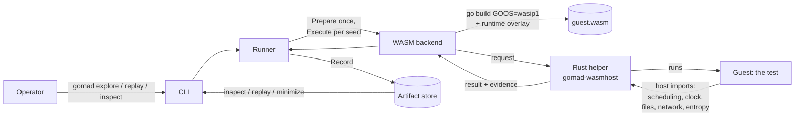
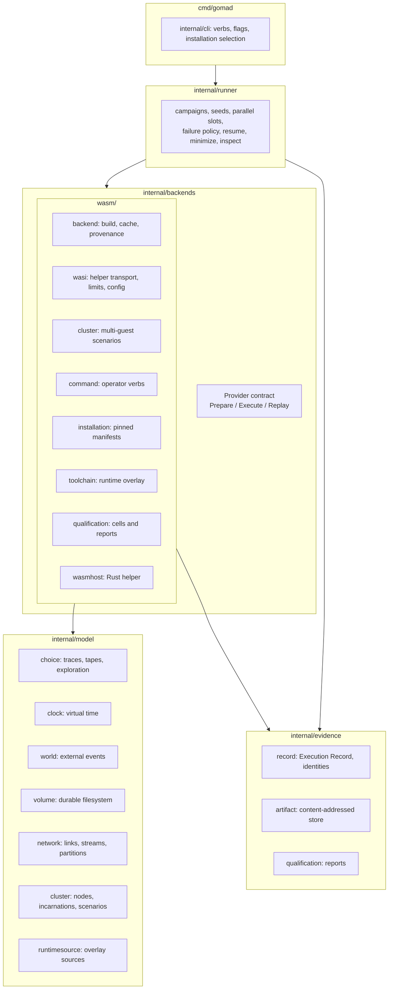
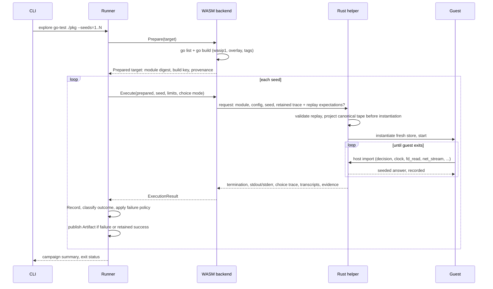
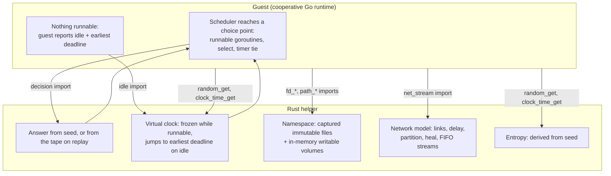
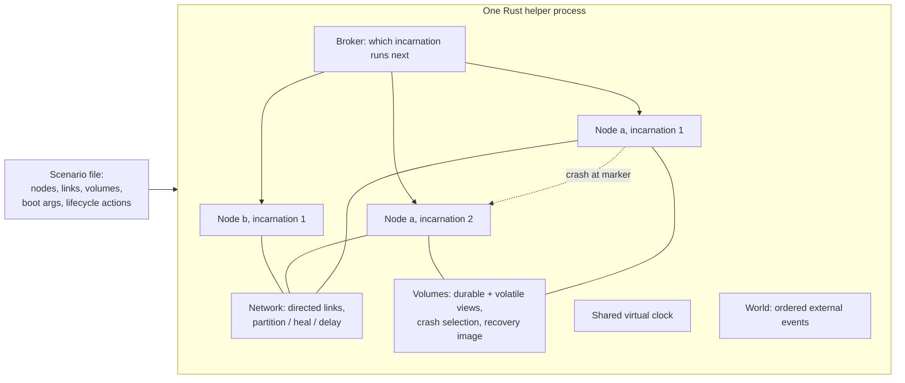
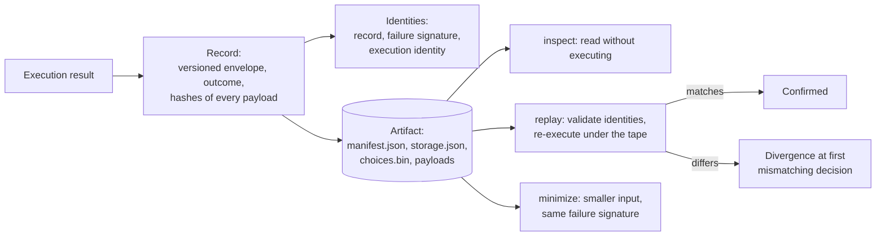
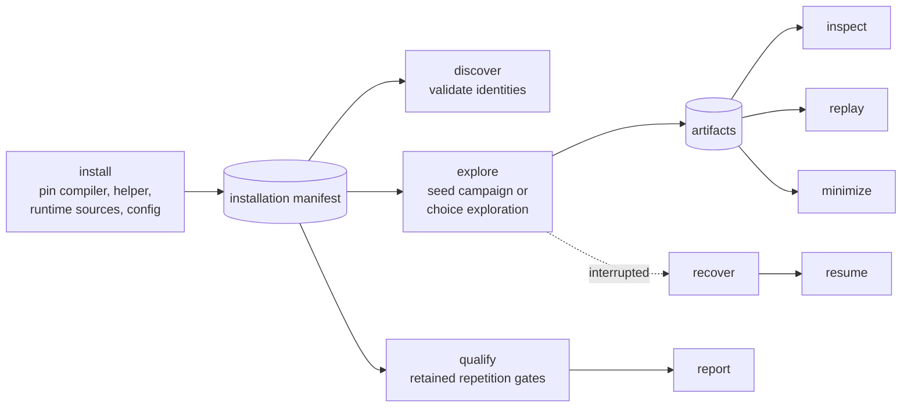

# Gomad architecture

The host implementation now lives in the single [Rust workspace](rust/README.md).
The Go CLI, runner and host qualification producers described in older sections
are retired source; retained Go code owns models, protocol generation, conformance
oracles and the guest runtime overlay. Current build and reference checks are
`make -C tools/gomad build`, `validate` and `test-wasm`. Final qualification uses
the [Rust driver](rust/driver/README.md) with frozen authenticated inputs and the unchanged
3,600-second limit. This prospective source consolidation supplies no R12/R13
acceptance; the conductor retains the frozen Go baseline until those gates pass.

Gomad explores Go tests under deterministic models. The WASM backend compiles a
test to WebAssembly and executes it with a Rust helper. The cooperative profile
adds a pinned runtime overlay for guest scheduling; the helper models supported
clock, filesystem, entropy and network operations. Failures and selected
successes are retained as immutable artifacts for inspection and replay, with
capabilities bounded by the selected profile and qualification evidence.
Running a cooperative test under many seeds explores different goroutine
schedules, timer orders and modeled network and storage behaviors.

This document is the map. The [README](README.md) is the operator walkthrough,
the [WASM operator guide](internal/backends/wasm/CLI.md) has every command, the
[qualification contract](internal/backends/wasm/QUALIFICATION.md) says what is
proven, and [SPEC.md](SPEC.md) defines the vocabulary used below.

## The big picture

Four ideas carry the whole system:

- **Seeded execution.** One seed fixes every choice Gomad makes for one
  execution: which goroutine runs next, which select case wins, how timers tie,
  what random bytes the guest sees, how the modeled network and storage behave.
- **Sealed guest.** The test never touches the host. Files come from captured
  immutable bytes and an in-memory namespace, network links are modeled, the
  clock is virtual, and entropy derives from the seed. Anything else is refused
  before execution, never emulated.
- **Evidence first.** Every execution produces a Record; failures and selected
  successes are published as content-addressed Artifacts that bind the module,
  helper, inputs and decisions by digest. Replay validates those identities
  before re-executing.
- **Model fidelity by differential testing.** The Rust helper owns the clock,
  World, volume and network models at run time. Go keeps reference
  implementations of the same models, and checked-in conformance corpora hold
  the two equal.

## Module map

| Layer | Owns | Does not own |
| --- | --- | --- |
| `cmd/gomad` | Parsing, installation resolution, exit statuses, presentation | Any semantics |
| `internal/runner` | Campaign control: which seeds run, how many in parallel, when to stop, how to resume, how to minimize | Executing a guest, building a module |
| `internal/backends` | The neutral `Provider` contract; the WASM implementation of it | Campaign policy |
| `internal/model` | The deterministic models and their reference implementations | Host I/O, goroutines, callbacks |
| `internal/evidence` | Records, artifacts, identities, qualification reports | Model semantics |
| `internal/host` | The only host filesystem and process primitives | Anything above |

The Runner imports no concrete backend. The backend imports models and
evidence contracts. Models perform no host I/O and start no goroutines. The
architecture checker in `internal/archcheck` enforces these edges.

## One execution, end to end

**Prepare** happens once per target. The backend verifies the pinned compiler
and helper by digest, applies the cooperative runtime overlay from
`internal/model/runtimesource`, builds the module with the declared build tags,
and records provenance: every source file hash, the module digest, the compiler
and helper identities, and the immutable guest configuration. The build key
derived from that provenance is part of every later identity, so a changed
source or toolchain is a different target, never a divergence.

**Execute** happens once per seed in a fresh helper store. The helper answers
every import the guest makes. A result carries a termination class, the
captured output, the choice trace, the I/O, storage and network transcripts,
and model evidence.

| Termination | Meaning |
| --- | --- |
| `exit` | The guest ran to completion; its exit code is the application outcome |
| `unsupported` | The guest asked for something outside the sealed boundary; refused before any emulation |
| `capacity` | A declared limit was hit: fuel, memory, calls, output, transcript bytes |
| `divergence` | Replay observed a decision or input that does not match the retained artifact |
| `trap` | The WebAssembly engine trapped |
| `infrastructure` | The helper, cache or host failed; not an application outcome |

## Where determinism comes from

Three things can make a Go test behave differently from run to run: goroutine
scheduling, time, and the outside world. Gomad controls each at a different
boundary.

**Scheduling.** The cooperative profile compiles the test against a small
runtime overlay. The overlay keeps one logical processor, disables
asynchronous preemption, and at each choice point asks the helper which
alternative to take. The helper draws from the seed and records the decision.
The recorded sequence is the Choice Trace; its branching decisions form the
Decision Tape projected by the Rust helper from retained raw trace bytes on
forced replay. Go supplies expected trace/tape digests and decision count, not
decoded tape decisions. Readiness and
single-alternative decisions are kept as evidence but never forced.

**Time.** The guest clock is virtual and starts at a fixed epoch. While any
goroutine is runnable the clock does not move. When the runtime proves nothing
is runnable, the guest reports idle and its earliest timer deadline, the helper
advances the clock to that instant, and every timer due at that instant
becomes eligible. A busy loop therefore never lets time pass, and a wall-clock
watchdog in the Runner bounds it.

**Outside world.** The helper implements a closed subset of WASI preview1 plus
the `gomad_wasm_v1` and `v2` import modules. Unknown imports, wrong signatures
and operations outside the subset are refused at module load. Files resolve
against captured immutable inputs and in-memory volumes; sockets resolve
against the network model; random bytes come from the seed. Nothing reaches
the host.

Two profiles exist. `gomad.wasi-stock-exploratory/v1` runs an unmodified Go
build with modeled imports and supports observed replay only.
`gomad.wasi-cooperative/v1` adds the runtime overlay and is the profile that
supports exact replay, choice exploration, and typed scenarios. Everything
below assumes the cooperative profile.

The [WASM determinism inventory](internal/backends/wasm/determinism/inventory.json)
records each reviewed influence as controlled, recorded, rejected or escaped.
Source-derived completeness checks cover imports, runtime patches, seeded
streams, host effects and engine settings. The inventory binds its review to
the pinned compiler, Wasmtime and Rust versions. Its
[documented escapes](internal/backends/wasm/README.md#known-determinism-escapes)
bound the guarantee.

Diagnostic traces retain seeded draw counters at choice points. Same-seed
[stress](rust/STRESS.md) compares fresh recordings while changing host CPU
load, concurrency, executable/working-directory/temporary-path layout or
broker handoff timing in the linked engine. Forced replay answers a different question:
it validates a retained tape, while same-seed recordings check whether the seed
and declared inputs determine the observed execution. Stress reports must bind
the actual host, workload and identities; native soak reports do not qualify
WASM. First-divergence reports require diagnostic evidence and use retained
execution coordinates to identify a replay prefix. Missing diagnostics or an
unauthenticated prefix make a comparison `undiagnosable`, never a pass.

## Clusters and scenarios

A single guest is one process. Temporal tests need several: nodes that crash
and restart, links that partition and heal, volumes that survive a crash. A
typed scenario declares that topology, and one helper process runs every
incarnation of every node in its own fresh store.

- **Node and incarnation.** A node has a stable identity and address. Each
  boot is a new incarnation with a fresh store; restart keeps the address and
  the durable volumes and revokes every old handle, connection and mapping.
- **Broker.** Only one incarnation runs at a time. The broker hands the baton
  in a deterministic order derived from the seed and the World event queue.
- **World.** A pure event queue for everything outside the runtime: ordered by
  logical time, priority, resource and a seed-derived rank. Pointers, host
  timestamps and map order are never ordering inputs.
- **Network.** Directed links with fixed delay. Partition holds every
  undelivered byte; heal releases them in order. Graceful stop drains and
  closes; crash resets both sides.
- **Volumes.** Writes land in a volatile view; sync moves them to the durable
  view. A crash selects which unsynced writes survive, and the recovery image
  is what the next incarnation boots from.

The Go packages under `internal/model` hold reference implementations of the
clock, World, volume, network and namespace models. They are not on the
execution path for clusters; they are the oracles the Rust implementations are
checked against by the conformance corpora under
`rust/wasmhost/tests/testdata` and `internal/model/wasi/testdata`. A change
to a model is a change to a corpus, reviewed as an expectation diff.

The volume and network models are gomad's own source, not derived from the
native backend: fn-219 promoted them from projections of the native runtime
overlay, so the Go model is the single reference. The wire codecs shared by Go
models, the WASM toolchain overlay and the Rust helper are rendered from the
schemas under `internal/model/schema`, `internal/model/choice/schema` and
`internal/model/world/schema` by `internal/model/generation/protocol`, run as
`internal/model/cmd/protocolgen` (`make generate`, checked by `make validate`)
with stock Go and no build tag. The native backend and its generated consumers
were removed by fn-223; fn-128/fn-149 closed as won't-do on 2026-10-19.
The glue removal changes shared-cluster source identity and its transitive
WASM bindings; historical qualification cannot be relabeled for that candidate.
Final runtime, mandatory workload and retained-replay qualification, including
the complete behavioral reach of `make -C tools/gomad test-wasm`, remain
pending under fn-232 R12/task .13's frozen Rust qualification cycle. Source
checks for the deletion supply no final qualification pass.

The helper transcript corpus is the shared Rust/Go wire and evidence contract.
Regeneration compares repeated executions, and a second pass must leave the
fixtures byte-identical. Unit tests retain invariants that fixtures cannot
express, such as lock handling, overlap counters and allocation-free probes;
coverage must establish replacement before a test is deleted.

Measurement producers live behind the explicit `wasmmeasure` command, outside
test targets. They retain their host-admission, identity and resource checks.
The [WASM implementation guide](internal/backends/wasm/README.md) documents the
regeneration workflow and command invocation.

## Evidence: records, artifacts, replay

A **Record** is the canonical description of one execution: outcome, output
hashes, the choice trace, model evidence and the identities of everything that
produced it. Diagnostic paths and host timestamps are excluded so byte-equal
behavior yields byte-equal records. The **failure signature** also excludes the
seed, so the same bug found under different seeds groups together.

An **Artifact** packages a Record with the inputs needed to replay it. It is
written by staging, syncing and a no-replace rename, so a crash can leave an
unreferenced directory but never a half-published artifact. Artifacts are
content-addressed and carry a storage lineage; an artifact from an earlier
lineage is refused, never migrated.

**Exact replay** first validates that the installed helper, module and runtime
identities match the artifact. The helper admits bounded raw trace frames,
validates their digest and execution identity, and projects the canonical
Decision Tape against the expected tape digest and count before instantiation.
Prefix controls travel separately from the unchanged trace evidence. Every
decision is validated before it is applied; the first mismatch is
reported as a divergence with its ordinal. The stock profile offers observed
replay: a fresh execution compared with the retained outcome and evidence,
without forcing the recorded scheduling decisions.

**Choice exploration** takes one base seed and systematically forces
alternative decisions at increasing prefixes, in bounded breadth-first rounds.
Each round is a hash-linked transaction so an interrupted campaign resumes from
its last complete round. Bounds on executions, depth and bytes are required;
exhausting them reports the explored envelope, not a proof of coverage.

## Operator surface

`install` never downloads anything. It pins existing tools by digest and writes
a manifest with the complete immutable guest configuration. `discover` checks
the manifest and helper bytes without opening the compiler or sources, so
retained replay still works after build inputs are gone. The CLI resolves the
installation from `--installation`, then `GOMAD_WASM_INSTALLATION`, then a
manifest beside the binary, and never falls back from an invalid one.

## Qualification

Nothing in the code claims support; the retained qualification record does.
`qualify` runs a workload under repeated seeds and fresh instances, replays
every retained execution, and binds the result to the exact candidate: source,
helper, module, model, compiler, host, profile and limits. The current cells
are a small fixture, a SQLite storage workload, a one-box Temporal workload and
a multi-instance cluster scenario. A passing cell qualifies that cell on that
candidate; it is not a claim about arbitrary tests, other hosts, or
performance. See the [qualification contract](internal/backends/wasm/QUALIFICATION.md).

## What is not claimed

- Determinism of arbitrary host I/O. Anything outside the sealed boundary is
  refused, not simulated.
- Schedule stability across source or toolchain changes. Identity binds the
  target; a different build is a different target.
- Exhaustive exploration. Every search is bounded and reports its envelope.
- Cross-host replay. Artifacts replay on their recorded profile and identities.
- Data-race detection or weak-memory coverage.

## Where to read next

- [README](README.md): installation to a retained failure, step by step.
- [WASM operator guide](internal/backends/wasm/CLI.md): every verb and flag.
- [WASM README](internal/backends/wasm/README.md): helper layout, corpora,
  regeneration.
- [Qualification](internal/backends/wasm/QUALIFICATION.md): cells, gates,
  measured costs.
- [SPEC](SPEC.md): definitions and product claims.
